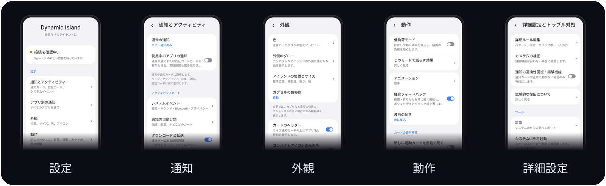

<p align="center">
  
</p>

<h3 align="center">ステータスバーに命を!</h3>

<p align="center">
  <b>Samsung One UI のための Dynamic Island。</b><br>
  カメラ穴のまわりのピルが、通話・音楽・ナビ・タイマー・通知のライブカードに広がります。
</p>

<p align="center">
  <a href="https://github.com/sampple-korea/dynamicisland/releases/latest"></a>
  
  
  <a href="LICENSE"></a>
</p>

<p align="center">
  <a href="https://github.com/sampple-korea/dynamicisland/releases/latest"></a>
  <a href="https://apps.obtainium.imranr.dev/redirect?r=obtainium://add/https://github.com/sampple-korea/dynamicisland"></a>
</p>

<p align="center">
  <a href="README.md">English</a> · <a href="README.ko.md">한국어</a> · <b>日本語</b> · <a href="README.zh.md">中文</a> · <a href="README.ru.md">Русский</a> · <a href="README.tr.md">Türkçe</a> · <a href="#機能">機能</a> · <a href="#インストール">インストール</a>
</p>

### カプセルが見せるものを、すべてカードに

ピルは標準の Now Bar カプセルがあった場所に置かれ、カードに広がります。

<p align="center">
  
</p>

Dynamic Island は、ステータスバーにある Samsung の Now Bar カプセルを、カードに成長するピルに置き換えます。One UI がカプセルに表示するもの(通話、タイマー、画面録画、キャスト、ナビ、音楽プレーヤー)はカードになり、ふつうの通知(メッセージ、認証コード、ダウンロード、アプリがテキストでしか書かない配達・配車・経路の更新)もカードになります。System UI の中で動く LSPosed モジュールで、One UI 風の設定アプリとルールマネージャーが付属します。

## スクリーンショット

<p align="center">
  
</p>

<p align="center">
  
</p>

これらの画像は、テスト環境のモック端末上でアプリ自身の描画コードが描いたものです(`scripts/readme_images.py` 参照)。実機の写真ではなく、アプリアイコンも単純な図形でできています。

## 0.1.13の新機能

0.1.13開発版の変更をまとめた安定版です。音楽に反応する共通グロー、整理した設定、任意の充電・イヤホンカード、録画時間とシステムフォントの修正、ライブ通知の長押しクラッシュ修正を含みます。円形バッテリーゲージと縮小表示を改善し、カードの角は標準28dp、任意で0–48dpに調整できます。Samsungボイスレコーダーの実験的波形は初期値オフで、「詳細設定とトラブルシューティング」から対応端末で有効にできます。

[リリースノート](docs/release-notes/0.1.13.md) · [現在のカード36例](docs/cards-overview-0.1.13.png)（サンプルデータ、任意の機能を含む）。

## 機能

- **ライブ通知をカードに:** System UI のあらゆる進行中アクティビティに、コンパクトなピルと展開カードが付きます。ヘッダー、ストップウォッチ、説明、通常/分割/不確定の進行バー、アイコンまたはテキストのボタン、カスタムチップ表示、仕事用プロファイルのバッジ。通話、キャスト、画面録画、タイマー、音楽プレーヤー(シークバー、ジャケット色の光彩、波形、出力先)も含みます。
- **ふつうの通知をカードに:**
  - メッセージやバナーは、標準のヘッドアップバナーの代わりにアイランドのカードとして開きます(通話とアラームは標準バナーのままです)。
  - 認証コードには「コピー」ボタン付きのカードが出ます(自動コピーも任意で、機密として扱われます)。
  - ダウンロード、コピー、アップデートは進行カードになります。「73%」「12 MB / 40 MB」のようにテキストだけで書かれた進行も対象です。カード表示中は、通知シェードの元の行を隠せます。
  - 音声チャットや VoIP 通話は、通話時間と終了ボタン付きの通話カードになります。
- **データとしてのルール:** 配達、受け取り、荷物、配車、経路、ウェアラブル、バッテリーのカードは、LiveBridge の辞書形式のルールファイルから作られます。モジュールには、一年半分の実際の通知から作った韓国語のルールファイルと英語のルールファイルが同梱されています。何もダウンロードせず、モジュールにネットワーク権限はありません。自分のルールをクリップボードから追加できます。
- **システムイベント:** 充電、バッテリー残量低下、サウンドモード、バッテリー付きの Bluetooth 音声、カメラ/マイク/位置情報の使用、クイック設定のフィードバック(サイレント、機内モード、省電力、ライト、テザリング、自動回転)。
- **アプリごとの制御:** ふつうの通知機能の対象アプリを、ブラックリストまたはホワイトリストで絞れます。ライブ通知、メディア、通話、システムイベントはフィルターされません。
- **モーション:** つぶれと伸びのあるスプリング式アニメーション、ピルとカードの間の液体ブリッジ、ピルから成長するカード。
- **One UI 風の設定アプリ:** サブページ付きのグループカードのハブ。英語・韓国語・日本語・中国語（簡体字）・ロシア語・トルコ語に対応します。
- **6言語の翻訳:** 設定・アイランドの文言・段階名を英語基準のAndroid文字列で管理します。他のアプリの通知文は変更せず、内蔵の内容判定は韓国語・英語のままです。Javaを変更せずに言語を追加する方法は[翻訳ガイド](docs/TRANSLATING.md)をご覧ください。
- **安全性:** System UI のクラッシュが繰り返されるとクラッシュガードがモジュールを停止します。フックはグループごとに分離され、診断ページでモジュールが System UI 内で何をしたかを確認できます。

## 機能の詳細

### アイランド本体

- **ピルとカード。** 黒いコンパクトなピルがカメラ穴を囲んで成長します。タップするとカードが開き、各カードにはアプリ、いま起きていること、ボタンが表示されます。複数のものは重要度順に積み重なります(通話、ヘッドアップカード、ナビ、録画、タイマー、イベント、ライブ通知、タスク、音楽、充電の順)。
- **ジェスチャー。** ピルを押してタップすると開きます。横にスワイプして項目を切り替え、項目をスワイプして小さな泡に退避させます(泡をタップすると戻ります)。開いたカードはドラッグでき(輪ゴムのように指に付いてきて、横方向では 1 枚が動きます)、カードをタップするとそのアプリが開き、ボタンを押せ、音楽カードのシークバーをなぞれます。ピルを下にドラッグすると通知シェードを引き下ろせます(ドラッグは System UI に再生されます)。
- **自分で畳まれます。** 開いたアイランドは、設定した時間がたつと閉じます。一時停止したプレーヤーも、設定した時間で退場します。
- **邪魔をしません。** ロック画面、常時表示ディスプレイ、全画面アプリ、横向きのスマートフォンでは隠れます(タブレットでは表示されます)。ロック解除の直後は、少し待ってから現れます。いま使っているアプリの項目は保留され、そのアプリを離れると飛び込んできます。 **動作 → 縦向きの全画面でも表示**（初期値はオフ）を有効にすると、カメラなどステータスバーを隠す縦向きのアプリでも進行中のアクティビティを表示できます。ロック画面、常時表示ディスプレイ、表示する内容がないときは引き続き非表示になります。
- **きれいに置き換えます。** Samsung 標準の進行中アクティビティのチップ、そのアニメーション、ピルの下のステータスバーアイコンと時計はフェードアウトまたは非表示にされ、同じ情報はアイランド 1 か所にまとまります。同じ通知の重複(たとえば LiveBridge アプリのコピー)は 2 回表示されません。
- **なじむ見た目。** カードの背後のすりガラス(Samsung のブラー)、アプリアイコンやアルバムアートから取った色、白いグリフのアバターは読みやすいよう暗い円盤の上のアプリアイコンに置き換え、仕事用プロファイルのバッジ、システムフォント、開閉やボタン押下時の触覚フィードバック(オフにできます)。
- **モーション。** すべての動きが固有の感触を持つスプリングです。ピルは落ちてきて一度弾み、サイズが変わるとつぶれて伸び、カードに注がれて元に膨らみ、カードは上に引き戻されて去ります。ピルとカードの間の液体ブリッジは砂時計のように細くなり、くびれて切れ、小さく揺れて戻り、触れ合うとまた一つになります。ボタンを押すと、そのカードだけに押下エフェクトが出ます。

### ライブ通知(Samsung の進行中アクティビティ)

- One UI が Now Bar カプセルに表示するものはすべてカードになります。時刻付きのアプリヘッダー、タイトル、2 行目とアイコン、説明、ストップウォッチ(カウントアップ/ダウン、1 行目または 2 行目の位置)、通常・分割(マーカーアイコン付き)・不確定の進行バー、アクションごとの色を持つ丸いアイコンボタンやテキストボタン、アプリのカスタムチップ表示、仕事用プロファイルのバッジ。
- **Android 16 ProgressStyle:** 色分けされた区間(経過と残り)、マイルストーン、トラッカーアイコン。
- **通話:** システムの通話チップから、発信者、通話時間、ミュート/スピーカー/終了ボタン。
- **タイマーとストップウォッチ**(回転する数字、ストップウォッチは 100 分の 1 秒まで)、**画面録画**、**キャスト**、**ナビ**。
- **音楽プレーヤー:** シークバー、再生/一時停止/前へ/次へ、縦横比を保ったアルバムアート、カードの形に沿ってアートから色づけされる光彩、実際の音声出力で動く波形(控えめなアニメーションにもできます)、音の行き先のラベル(バッテリー付きの Bluetooth 機器、有線ヘッドセット、キャスト先)。

### ふつうの通知をカードに

- **メッセージとバナー** は、ヘッドアップバナーの代わりにアイランドカード(送信者、メッセージ、アプリアイコンまたはアバター、通知自体のボタン、タップで開く)として開きます。通話、アラーム、全画面通知は標準バナーのままです。通知自体は通知シェードに残り、音も鳴ります。
- **認証コード:** コードを含むテキストは、コード、「コピー」ボタン付きのカードとして開き、任意で即座にコピーします(クリップボードのプレビューに出ないよう機密扱いです)。検出ではトリガー語とコードまでの距離を採点し、電話番号、価格、注文番号、広告は除外します。再投稿や別アプリのミラーで 2 回届くコードも、カードは 1 枚だけです。
- **ダウンロード、ファイルコピー、アップロード、アプリのアップデート:** 通知のバーとボタンを持つ進行カード。One UI のライブ通知に対応していないアプリでも動きます。「ダウンロード中 73 %」「12.4 MB / 40 MB」のようにテキストだけの進行も理解します。カード表示中は、通知シェードの元の行を隠せます。
- **音声チャットと VoIP 通話**(KakaoTalk の音声通話、Discord の音声など)は、通話時間と終了ボタン付きの通話カードになります。
- どのアプリをカードにするかは、ブラックリストまたはホワイトリストで制限できます。

### ルールによるカード

- **ルール** は通知を段階付きのカードにします。たとえば *注文済み、調理中、配達中、まもなく到着、配達完了*。モジュールには、一年半分の実際の通知から作った韓国語のルールファイルが同梱されています。
  - **配達と受け取り:** Coupang Eats、Baemin、Yogiyo、Pass order、Starbucks、Subway、Lotteria、McDonald's。
  - **荷物:** Smart Parcel(CJ ほか)、Coupang、Kream、AliExpress、Kurly、Gmarket、11st、各運送会社の公式アプリ。
  - **ナビ:** Naver Map、T map、Kakao Map、Kimgisa、Google Maps(徒歩、乗車、下車、到着、ピルに距離表示)。
  - **タクシー:** Kakao T、T map タクシー、Uber、Onda(呼び出し中、配車済み、接近中、乗車中、到着)。
  - **ウェアラブルとイヤホン:** Galaxy Ring、Watch、Buds の接続と切断(繰り返しはクールダウンで抑制)、満充電、バッテリー残量の低下。
  - **機器の接続:** いま接続した Bluetooth やアクセサリー機器の名前。
  - カードにならないメール、チャット、SNS、ニュースのアプリの一覧。
- **英語のルール** は、英語圏のアプリの通知の言い回しを元に、このプロジェクトのために書かれたものです。LiveBridge のファイルはコピーしていません。対象は次のとおりです。
  - **フードデリバリー:** DoorDash、Uber Eats、Grubhub、Postmates、Instacart、Domino's、Pizza Hut、Starbucks、Chipotle、Deliveroo、Just Eat、Wolt、Glovo ほか(注文受付、調理中、配達中、まもなく到着、配達完了)。
  - **荷物:** Amazon、UPS、FedEx、USPS、DHL、Royal Mail、Shop、Evri、Canada Post、Australia Post ほか(ラベル作成、輸送中、最寄り拠点、配達中、配達完了)。
  - **配車:** Uber、Lyft、Bolt、Grab、Ola、DiDi、FREE NOW、Cabify、inDrive(ドライバー検索中、ドライバー決定、向かっています、到着、乗車完了)。
  - **ナビ:** Google Maps、Waze、Citymapper、HERE、TomTom、MapQuest ほか(マイル、フィート、キロメートルでの距離付きの曲がり角、下車、到着)。
  - **アクセサリー:** Pixel Buds、Fitbit、Garmin、Galaxy Wearable などのアクセサリーアプリの接続、切断、満充電、バッテリー残量の低下。
  - チャット、メール、SNS、動画、ニュースのアプリは対象外です。段階の名前は端末の言語に従います。英語の端末では英語、韓国語の端末では韓国語です。
- 終わった処理のカードは数分後に、それ以外は数時間後に消えます。一日中繰り返すイベントはクールダウンごとに 1 回だけ表示されます。信号がパーセントを持っていれば、それがカードの進行度になります。
- ルールファイルは LiveBridge の辞書形式を使います。端末を固まらせかねないパターン(暴走する正規表現)はファイル読み込み時に拒否され、非常に長いテキストはマッチング前に切り詰められます。

### ルールマネージャー

- **ルールごとのスイッチ**、段階・アプリ・パターンを示す一覧、ルールごとの詳細ページ。
- **モジュールのルールに手を加えず追加:** 段階に名前を付ける、段階にパターンを足す、段階を足す(最大 9 つ)、アプリ(インストール済みから)や除外する言い回しを足す。ルールの変更はワンタップで全部元に戻せます。
- **新しいルールを作る:** 自分のアプリや言い回しのためのルール。
- **通知を試す:** アプリとテキストを入力すると、どのルールがどの段階で働くか、認証コードとして読まれるか、どんな進行度を持つかがすぐ分かります。
- ルールを JSON としてクリップボード経由で **インポート/エクスポート**。すべてのリセットも可能です。

### システムイベント

- **充電**(急速/ワイヤレス、リアルタイムのパーセント付き)、**バッテリー残量低下**、**サウンドモード**(サイレント、バイブ、通常)、**Bluetooth 音声** の接続(バッテリー残量付き)。
- **任意の端末カード:** **通知 → システムイベント**で充電詳細・充電統計・有線/USBイヤホン通知を有効にできます。すべて初期値はオフです。充電カードはイベントの優先度を維持し、表示中は短い充電ポップアップに代わります。統計には充電カードが必要で、各設定をオフにすると対応する収集も停止します。電力はバッテリー側の推定値で、画面状態別の充電量変化は観測区間に基づく推定値です。**詳細設定 → カメラ位置調整**では文字の追加余白を0–16dpで調整でき、0は従来の間隔を維持します。
- **Samsungのバッテリー充電エフェクト:** **通知 → システムイベント → Samsungのバッテリー充電エフェクトを表示**は初期値オフです。ステータスバーのバッテリーが拡大して色が流れる効果を抑え、通常のアイコン・残量・充電表示・充電音・アイランド通知は維持します。確認済みのOne UI 9 Compose経路とBatteryEventスケジューラー経路を存在する場合に処理し、未対応ビルドは従来の動作を維持します。
- **カメラ、マイク、位置情報の使用:** どのアプリがどのセンサーを使っているか。タップするとそのアプリの権限ページが開きます(ナビや天気のアプリが一日中使うため、位置情報は既定でオフです)。
- **クイック設定のフィードバック:** サイレント、機内モード、省電力、テザリング、自動回転のオン/オフ切り替え。
- **ライトの明るさ:** ライトがついている間にアイランドをタップすると、明るさの段階(Galaxy は 5 段階、カメラから読み取り)用の大きな iOS 風スライダーと消灯ボタンのあるカードが開きます。ライトの明るさが 1 段階しかない端末では、スライダーなしで状態と消灯ボタンだけのカードになります(*ライトのカード* スイッチをオフにすると、従来の「ライトがオンです」ポップアップになります)。
- どのグループも個別にオフにできます。

### 設定アプリ

- **外側のグロー（標準でオン・音楽セッションのみ）:** 音楽のピルが非表示でも、すべてのコンパクトなピルが音楽セッションの色と音への反応を共有します。アルバム連動では波形と同じ色を使い、一時停止で淡くなり、セッション終了時は最後の色を保って1.2秒で滑らかに消えます。音楽のみ／全アクティビティを選び、明るさ（標準45%）と動的効果（0–100%、標準50%）をプレビューで調整できます。テーマ色・個別のプリセット・HSV・HEXも利用でき、低負荷モードでは無効です。
- **低負荷モード（標準でオフ）:** 内容のぼかしをクロスフェードに、背景ぼかしを不透明な黒いカードに置き換えます。アルバム色と画像、波形、アイコンを静止表示し、音声解析を止めます。バッテリーの実際の状態は更新します。継続する動きは最大 30fps、タッチと展開・折りたたみは最大 60fps。個別設定は保持し、オフにすると再適用します。通知、通話、タイマー、音楽操作は使えます。
- **通知とアクティビティ**、**アプリ別の通知**、**外観**、**動作**、**詳細設定とトラブル対処**、**アプリ情報**の 6 グループ。英語、韓国語、日本語、簡体字中国語、ロシア語、トルコ語とライト・ダークテーマに対応します。ほとんどの変更は System UI の再起動なしで数秒以内に反映されます。
- **位置とサイズ:** 実際のステータスバーでのプレビュー、幅の自動・手動設定、スライダー、数値入力、1 単位の調整に対応。位置、サイズ、カメラ補正は個別にリセットします。カメラ穴の補正は詳細設定にあります。
- **通知とアプリ:** 通常の通知をオフ・バナーのみ・サイレントを含むから選択。常駐通知の取り込みは標準でオフです。アプリフィルターは通常の通知カードだけが対象。名前・パッケージ検索、選択済みのみの表示、保存・キャンセルに対応します。
- **外観と動作:** 標準・カスタムの色、キャンセル可能な HSV・HEX 編集、大きなイベントアイコン（標準）と小さなアイコン、充電バッテリーアイコン（標準で非表示）。アニメーションは実際の描画処理でプレビューし、選択をすぐ保存します。波形は音への反応とデモを選べます。
- **時間と復旧:** アクティビティの自動表示は標準でオフ。有効時の表示時間（標準 4 秒）は、手動で開いたカード（6 秒）や一時停止中の音楽（60 秒）と別設定です。試験的な通知復旧は互換性問題向けで、標準でオフです。
- **言語と状態:** 設定アプリの言語はアプリ情報で変更し、カードは端末の言語に従います。接続確認は古い診断結果ではなく System UI の新しい応答を使います。戻るとスクロール位置を復元します。

### 信頼性

- フックは **分離されたグループ** ごとに取り付けられます。お使いの System UI ビルドに取り付けられないものがあっても、他は止まりません。すべてのフック本体とすべてのデータソースは囲い込まれていて、失敗は System UI のクラッシュではなくログ 1 行になります。
- **クラッシュガード** は、System UI のクラッシュや不安定な起動が続くとモジュールを停止します。判定はシステムアップデート後または 12 時間後に忘れられ、直近のクラッシュの原因は保存されます。
- **診断ページ** は、System UI のバージョン、起動段階、取り付けられなかったフック、最近のエラー、前回のクラッシュを表示し、そのまま issue に貼り付けられます。
- System UI がステータスバーを報告しない場合、アイランドは 15 秒後に自分でウィンドウを作ります。
- アプリに **ネットワーク権限はなく**、データは端末の外に出ません。

## 動作環境

- One UI 7 / 8 / 9(Android 15 / 16 / 17)の Samsung 端末と標準の System UI。One UI 8 と 9 は実機で使われています。One UI 7 への対応は新しく、1 つの System UI ビルドに対してのみ確認していて、実機では確認していません([docs/COMPATIBILITY.md](docs/COMPATIBILITY.md) 参照)。
- LSPosed(モジュールの最小 SDK は 35)。
- root が必要なのは、任意の **System UI を再起動** ボタンだけです。

## インストール

1. プロジェクトの **Releases** にある署名済みの Dynamic Island APK をインストールします。なければソースからビルドしてください(下記)。
2. LSPosed で **Dynamic Island** を有効にし、スコープを **System UI**(`com.android.systemui`)にします。
3. System UI を再起動します(アプリの **System UI を再起動** ボタン、または端末の再起動)。
4. ランチャーから Dynamic Island を開きます。変更は数秒で反映され、再起動は不要です。

## 設定

| ページ | 内容 |
|---|---|
| 通知とアクティビティ | 通常の通知、システムイベント、自動分類、ダウンロード、通話、認証コード |
| アプリ別の通知 | 選択したアプリ以外・選択したアプリのみ、検索可能な一覧。通常の通知カードのみ対象 |
| 外観 | 色、位置とサイズ、ヘッダー、アイコンサイズ、充電アイコン、通知パネルの音楽 |
| 動作 | 標準・クラシック、振動、音反応・デモ波形、個別の表示時間 |
| 詳細設定とトラブル対処 | ルールのパターンと段階、クリップボード入出力、カメラ補正、試験的復旧、診断、System UI 再起動 |
| アプリ情報 | 設定アプリの言語、バージョン、作者、クレジット |

## うまく動かないとき

System UI を再起動したあと、アプリの **詳細設定とトラブル対処 → 診断** を開いてください。System UI のバージョン、起動段階、取り付けられなかったフック、エラー、前回のクラッシュが表示されます。**レポートをコピー** を使って、issue に添えて送ってください。

## ソースからのビルド

JDK 17 以上と Android SDK(compile SDK 36)が必要です。

```bash
./gradlew assembleRelease     # 署名なし APK は app/build/outputs/apk/release に出力
KEYSTORE_PASSWORD=... scripts/sign.sh   # ビルド、アラインメント、署名 -> release/DynamicIsland-<version>.apk
./gradlew testReleaseUnitTest # ユニットテストとヘッドレス描画テスト
./gradlew testReleaseUnitTest -Prender # 任意: 画面確認用のPNGを生成
```

`scripts/sign.sh` はキーストアのパスワードを `KEYSTORE_PASSWORD` から受け取り、初回実行時に `release-keys/` へ自己署名キーを作ります(git には含まれません)。アップデートは同じキーで署名する必要があるため、保管しておいてください。ソース構成、フックの注記、ルール形式、テスト環境は [`docs/DEVELOPMENT.md`](docs/DEVELOPMENT.md) を参照してください。

## リリース

この README は現在のソースに基づきます。リリース待ちの変更は最新の安定版 APK に含まれない場合があります。

署名済みの APK は [Releases](../../releases) ページで公開されます。ビルドは自動化されています([`docs/DEVELOPMENT.md`](docs/DEVELOPMENT.md) 参照)。すべてのリリースを同じキーで署名しているため、新しいバージョンは古いものの上にアップデートとしてインストールされます。

## プライバシー

モジュールは System UI の中で動き、System UI がすでに保持している通知を読みます。ネットワーク権限はなく、どこにも何も送りません。設定と診断レポートは端末内にとどまり、レポートに通知のテキストは含まれません。

任意の同時マイク波形は短いメモリ内バッファから音量を計算します。初期値はオフで、音声は保存も送信もしません。

## 免責

Dynamic Island は独立した非公式のプロジェクトで、Samsung とは関係がなく、Samsung の承認も受けていません。System UI の非公開クラスにフックするため、アップデートのたびに動かなくなる可能性があります。One UI 8 と 9 の実機で使われていますが、One UI 7 と Nothing OS は実機では確認されていません([docs/COMPATIBILITY.md](docs/COMPATIBILITY.md) 参照)。自己責任でお使いください。

## ライセンス

[MIT](LICENSE) © 2026 sampple-korea。

## 作者 [sampple-korea](https://github.com/sampple-korea)

## クレジット

- [LiveBridge](https://github.com/appsfolder/livebridge) — このプロジェクトが読み込むルールファイルの形式(LiveBridge のファイルは同梱していません)
- [Xposed API](https://api.xposed.info/)(Apache-2.0、`app/libs/xposed-api-82.jar`)と [LSPosed](https://github.com/LSPosed/LSPosed)
* @cryyear の DynamicIsland — このプロジェクトは同モジュールの APK の改変から始まりましたが、その後、独自のコードベースとアーキテクチャで再実装されました。現在は独立して開発・保守されています。
- Telegram の [@UnkilBonki](https://t.me/UnkilBonki) — 不具合修正、テスト、サポート。
