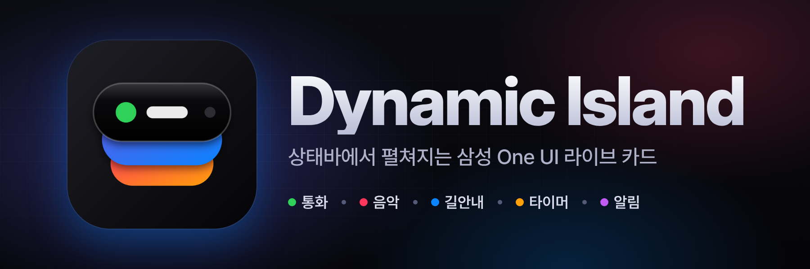
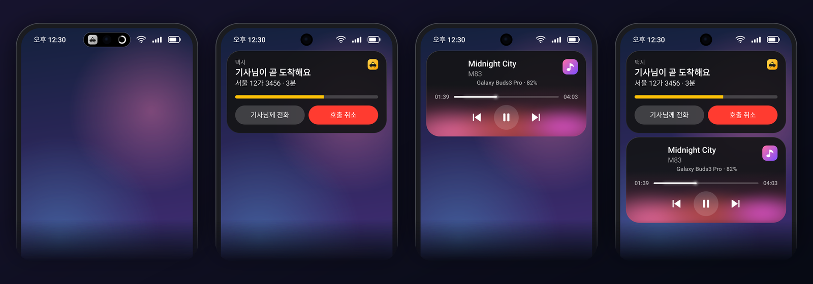
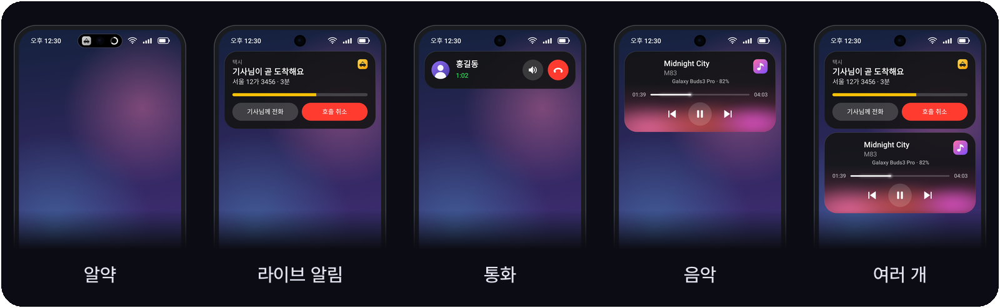
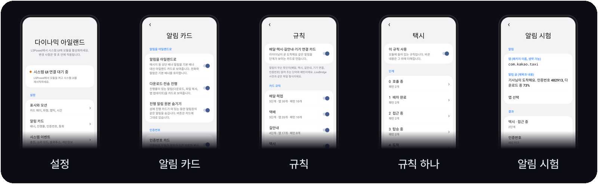

<p align="center">
  
</p>

<h3 align="center">상태바에 생기를!</h3>

<p align="center">
  <b>삼성 One UI용 다이나믹 아일랜드</b><br>
  카메라 구멍 둘레의 알약이 통화, 음악, 길안내, 타이머, 알림을 라이브 카드로 펼쳐 줍니다.
</p>

<p align="center">
  <a href="https://github.com/sampple-korea/dynamicisland/releases/latest"></a>
  
  
  <a href="LICENSE"></a>
</p>

<p align="center">
  <a href="https://github.com/sampple-korea/dynamicisland/releases/latest"></a>
</p>

<p align="center">
  <a href="README.md">English</a> · <b>한국어</b> · <a href="#주요-기능">주요 기능</a> · <a href="#설치">설치</a>
</p>

### 캡슐이 보여 주던 모든 것을 카드로

알약은 기본 Now Bar 캡슐 자리에 놓이고, 누르면 카드로 펼쳐집니다.

<p align="center">
  
</p>

다이나믹 아일랜드는 삼성 상태바의 Now Bar 캡슐을 카드로 펼쳐지는 알약으로 바꿔 줍니다. One UI가 캡슐에 담던 통화, 타이머, 화면 녹화, 화면 전송, 길안내, 음악 플레이어는 물론 메시지, 인증번호, 다운로드, 글로만 오던 배달·택시·경로 알림까지 카드로 보여 줍니다. 시스템 UI 안에서 도는 LSPosed 모듈이며, One UI 스타일 설정 앱과 규칙 관리 화면이 함께 들어 있습니다. [@cryyear의 DynamicIsland](https://github.com/Spottq)에서 영감을 받아 새로 구현했습니다.

## 스크린샷

<p align="center">
  
</p>

<p align="center">
  
</p>

이 그림들은 테스트 환경에서 앱의 실제 그리기 코드로 가상의 폰 위에 그린 것이며(`scripts/readme_images.py` 참고), 실제 기기를 찍은 사진이 아닙니다. 앱 아이콘은 단순한 도형으로 만든 가상의 아이콘입니다.

## 주요 기능

- **라이브 알림 카드:** 시스템 UI의 모든 진행 중 활동을 작은 알약과 펼친 카드로 보여 줍니다. 헤더, 스톱워치, 설명, 일반·구간·불확정 진행바, 아이콘·텍스트 버튼, 앱이 보내는 커스텀 칩, 업무 프로필 배지를 지원하고, 통화, 화면 전송, 화면 녹화, 타이머, 음악 플레이어(시크바, 앨범 색 글로우, 파형, 출력 기기)도 포함합니다.
- **일반 알림 카드:**
  - 메시지와 배너를 기본 헤드업 배너 대신 아일랜드 카드로 보여 줍니다(전화와 알람은 기본 배너를 그대로 씁니다).
  - 인증번호 문자가 오면 복사 버튼이 있는 카드를 보여 주고, 자동 복사 옵션도 있습니다.
  - 다운로드, 복사, 업데이트를 진행 카드로 보여 줍니다. "73%", "12 MB / 40 MB"처럼 글자로만 적힌 진행률도 읽어 내며, 카드가 떠 있는 동안 알림창의 원본 알림을 숨길 수 있습니다.
  - 음성 채팅·VoIP 통화는 통화 시간과 종료 버튼이 있는 통화 카드로 보여 줍니다.
- **규칙 파일로 만드는 카드:** 배달, 픽업, 택배, 택시, 길안내, 웨어러블, 배터리 카드는 LiveBridge 사전 형식의 규칙 파일로 만듭니다. 1년 반 동안 기록한 알림을 바탕으로 만든 한국어 규칙과 영어 규칙이 내장되어 있어서 따로 내려받을 것이 없고, 앱에 네트워크 권한도 없습니다. 클립보드로 내 규칙을 추가할 수도 있습니다.
- **시스템 이벤트:** 충전, 배터리 부족, 소리 모드, 배터리 잔량이 보이는 블루투스 오디오 연결, 카메라·마이크·위치 사용, 빠른 설정 변경(방해금지, 비행기 모드, 절전 모드, 손전등, 핫스팟, 자동 회전)을 알려 줍니다.
- **앱 관리:** 일반 알림 기능에 적용할 앱을 블랙리스트나 화이트리스트로 정합니다. 라이브 알림, 미디어, 통화, 시스템 이벤트는 걸러지지 않습니다.
- **모션:** 스프링 기반의 부드러운 애니메이션, 찌그러지고 늘어나는 효과, 알약과 카드를 잇는 액체 연결, 알약에서 자라나는 카드.
- **One UI 스타일 설정 앱:** 묶음 카드와 하위 페이지로 구성된 설정 화면이며 한국어와 영어를 지원합니다.
- **안전장치:** 시스템 UI가 반복해서 종료되면 크래시 가드가 모듈을 끄고, 후크는 그룹별로 격리되며, 진단 페이지에서 모듈이 시스템 UI 안에서 한 일을 확인할 수 있습니다.

## 상세 기능

### 아일랜드 기본 동작

- **알약과 카드.** 카메라 구멍 주위에 작은 검은 알약이 나타나고, 알약을 누르면 카드가 열립니다. 카드에는 앱, 현재 상황, 버튼이 표시됩니다. 여러 항목이 동시에 있으면 중요도 순으로 쌓입니다(통화, 헤드업 카드, 길안내, 녹화, 타이머, 이벤트, 라이브 알림, 작업, 음악, 충전 순).
- **제스처.**
  - 알약을 누르면 카드가 열리고, 옆으로 밀면 다음 항목으로 넘어갑니다.
  - 항목을 밀어 치우면 작은 방울로 옆에 남고, 방울을 누르면 돌아옵니다.
  - 펼친 카드는 고무줄처럼 손가락을 따라 움직이고, 옆으로 밀면 카드가 한 장씩 넘어갑니다.
  - 카드를 누르면 해당 앱이 열리고, 카드의 버튼을 누를 수 있으며, 음악 카드의 시크바를 끌어서 재생 위치를 옮길 수 있습니다.
  - 알약을 아래로 끌면 알림창이 내려옵니다(끄는 동작이 시스템 UI로 전달됩니다).
- **자동으로 접힘.** 펼친 아일랜드는 정한 시간이 지나면 접히고, 일시정지된 플레이어는 정한 시간이 지나면 사라집니다.
- **필요할 때만 나타남.** 잠금 화면, 상시 표시 화면(AOD), 전체 화면 앱, 가로 모드의 폰에서는 숨습니다(태블릿에서는 유지). 잠금을 푼 뒤에는 잠깐 기다렸다가 나타납니다. 지금 쓰는 앱의 항목은 숨겨 두었다가, 그 앱을 떠나면 다시 나타납니다.
- **기존 칩 대체.** 삼성의 진행 중 활동 칩과 그 애니메이션은 숨기고, 알약 아래의 상태바 아이콘과 시계는 흐리게 처리해서 같은 정보를 아일랜드 한 곳에서 보여 줍니다. 같은 알림의 복사본(예: LiveBridge 앱이 만든 알림)은 두 번 나오지 않습니다.
- **모양과 느낌.** 카드 뒤에 삼성 블러를 쓴 반투명 유리 효과를 넣고, 앱 아이콘이나 앨범 아트에서 뽑은 색을 씁니다. 흰색 글리프 아바타는 어두운 원판 위의 앱 아이콘으로 바꿔서 잘 보이게 하고, 업무 프로필 배지와 시스템 글꼴을 따릅니다. 열고 닫을 때와 버튼을 누를 때는 햅틱이 울립니다(끌 수 있음).
- **모션.** 모든 움직임이 각자의 느낌을 가진 스프링입니다. 알약은 떨어지듯 나타나 한 번 튕기고, 크기가 바뀔 때 찌그러지고 늘어나며, 카드로 쏟아져 들어갔다가 다시 부풀어 오릅니다. 카드는 위로 빨려 들어가며 사라집니다. 알약과 카드 사이의 액체 연결은 모래시계처럼 가늘어지다 끊어지고, 작게 출렁이며 돌아갔다가 다시 만나면 합쳐집니다. 버튼을 누르면 그 카드에만 눌림 효과가 나타납니다.

### 라이브 알림 (삼성 진행 중 활동)

- One UI가 Now Bar 캡슐에 보여 주는 모든 것이 카드가 됩니다. 앱 이름과 시간이 있는 헤더, 제목, 보조 줄과 아이콘, 설명, 스톱워치(증가·감소, 주·보조 위치), 일반·구간(표시 아이콘 포함)·불확정 진행바, 동작별 색을 쓰는 둥근 아이콘 버튼과 텍스트 버튼, 앱이 보내는 커스텀 칩, 업무 프로필 배지를 지원합니다.
- **Android 16 ProgressStyle:** 구간 색(경과·남음), 이정표 점, 트래커 아이콘.
- **통화:** 시스템 통화 칩의 정보로 통화 상대, 통화 시간, 음소거·스피커·끊기 버튼을 보여 줍니다.
- **타이머와 스톱워치**(숫자가 롤링되고 스톱워치는 1/100초까지 표시), **화면 녹화**, **화면 전송(캐스트)**, **길안내**.
- **음악 플레이어:** 시크바, 재생·일시정지·이전·다음 버튼, 비율을 지킨 앨범 아트, 카드 모양에 맞춰 커지고 작아지는 앨범 색 글로우, 실제 오디오 출력으로 움직이는 파형(원하면 부드러운 애니메이션으로 대체), 소리가 출력되는 기기 표시(배터리 잔량이 보이는 블루투스 기기, 유선 헤드셋, 캐스트 대상).

### 일반 알림 카드

- **메시지와 배너**는 헤드업 배너 대신 아일랜드 카드로 열립니다(보낸 사람, 메시지, 앱 아이콘이나 아바타, 알림의 버튼, 눌러서 앱 열기). 전화, 알람, 전체 화면 알림은 기본 배너를 그대로 씁니다. 알림은 알림창에 그대로 남고 소리도 그대로 납니다.
- **인증번호:** 인증번호가 담긴 문자가 오면 번호와 복사 버튼이 있는 카드를 보여 주고, 원하면 바로 복사합니다(클립보드 미리보기에 보이지 않도록 민감 정보로 표시). 트리거 단어와 번호 사이의 거리를 점수로 매겨 감지하고, 전화번호, 가격, 주문번호, 광고는 걸러 냅니다. 같은 번호가 두 번 오면(다시 게시되었거나 다른 앱이 복사한 경우) 카드는 하나만 나옵니다.
- **다운로드, 파일 복사, 업로드, 앱 업데이트:** 알림의 진행바와 버튼이 있는 진행 카드를 보여 줍니다. One UI 라이브 알림을 지원하지 않는 앱도 포함합니다. 글자로만 적힌 진행률("다운로드 중 73%", "12.4 MB / 40 MB")도 읽어 냅니다. 카드가 떠 있는 동안 알림창의 원본 알림을 숨길 수 있습니다.
- **음성 채팅·VoIP 통화**(카카오톡 보이스톡, 디스코드 음성 등)는 통화 시간과 종료 버튼이 있는 통화 카드로 보여 줍니다.
- 어떤 앱의 알림을 카드로 바꿀지는 블랙리스트나 화이트리스트로 정합니다.

### 규칙으로 만드는 카드

- **규칙**은 알림을 단계가 있는 카드로 바꿉니다. 예: *주문, 조리 중, 배달 중, 곧 도착, 배달 완료*. 모듈에는 1년 반 동안 기록한 알림을 바탕으로 만든 한국어 규칙 파일이 들어 있습니다.
  - **배달·픽업:** 쿠팡이츠, 배달의민족, 요기요, 패스오더, 스타벅스, 서브웨이, 롯데리아, 맥도날드.
  - **택배:** 스마트택배(CJ 등), 쿠팡, 크림, 알리익스프레스, 컬리, 지마켓, 11번가, 택배사 앱.
  - **길안내:** 네이버 지도, T맵, 카카오맵, 김기사, 구글 지도(도보, 승차, 하차, 도착 단계와 남은 거리 표시).
  - **택시:** 카카오 T, T맵 택시, 우버, 온다(호출, 배차, 접근, 탑승, 도착).
  - **웨어러블·이어버드:** 갤럭시 링, 워치, 버즈의 연결과 연결 해제(반복되는 알림은 쿨다운으로 억제), 충전 완료, 배터리 부족 퍼센트.
  - **기기 연결:** 방금 연결된 블루투스나 액세서리 기기의 이름.
  - 카드로 만들지 않을 메일, 채팅, 소셜, 뉴스 앱 목록도 들어 있습니다.
- **영어 규칙**은 영어권 앱이 알림 문구를 쓰는 방식을 보고 이 프로젝트를 위해 새로 쓴 것이며, LiveBridge 파일을 복사하지 않았습니다. 다음을 다룹니다.
  - **음식 배달:** DoorDash, Uber Eats, Grubhub, Postmates, Instacart, 도미노피자, 피자헛, 스타벅스, 치폴레, Deliveroo, Just Eat, Wolt, Glovo 등(주문, 준비 중, 배달 중, 곧 도착, 배달 완료).
  - **택배:** 아마존, UPS, FedEx, USPS, DHL, Royal Mail, Shop, Evri, Canada Post, Australia Post 등(송장 생성, 이동 중, 지역 터미널 도착, 배송 출발, 배송 완료).
  - **차량 호출:** Uber, Lyft, Bolt, Grab, Ola, DiDi, FREE NOW, Cabify, inDrive(기사 찾는 중, 배차, 이동 중, 도착, 운행 완료).
  - **길안내:** 구글 지도, Waze, Citymapper, HERE, TomTom, MapQuest 등(마일·피트·킬로미터 거리가 표시되는 회전 안내, 하차, 도착).
  - **액세서리:** Pixel Buds, Fitbit, Garmin, Galaxy Wearable 등의 연결·연결 해제, 충전 완료, 배터리 부족 퍼센트.
  - 채팅, 메일, 소셜, 동영상, 뉴스 앱은 제외합니다. 단계 이름은 폰의 언어를 따라 영어 폰에서는 영어, 한국어 폰에서는 한국어로 나옵니다.
- 끝난 과정의 카드는 몇 분 뒤에, 나머지는 몇 시간 뒤에 사라집니다. 하루에도 여러 번 반복되는 이벤트는 쿨다운 시간마다 한 번만 보여 주고, 패턴이 퍼센트 값을 읽어 오면 그 값이 카드의 진행률이 됩니다.
- 규칙 파일은 LiveBridge 사전 형식을 따릅니다. 무한히 오래 걸릴 수 있는 정규식은 파일을 읽을 때 거부하고, 아주 긴 글은 검사 전에 잘라 냅니다.

### 규칙 관리

- 모든 규칙에 **켜기·끄기 스위치**가 있고, 단계·앱·패턴을 보여 주는 목록과 규칙별 상세 화면이 있습니다.
- **기본 규칙은 그대로 두고 내 규칙 추가:** 단계 이름 붙이기, 단계에 패턴 추가, 단계 추가(최대 9단계), 앱 추가(설치된 앱에서 선택), 제외 문구 추가를 할 수 있습니다. 규칙별로 내가 바꾼 내용은 한 번에 되돌릴 수 있습니다.
- **새 규칙 만들기:** 내가 쓰는 앱과 문구로 직접 규칙을 만듭니다.
- **알림 시험:** 앱과 알림 글을 입력하면 어떤 규칙이 몇 단계로 작동하는지, 인증번호로 읽히는지, 어떤 진행률이 들어 있는지 바로 보여 줍니다.
- **가져오기·내보내기:** 내 규칙을 JSON으로 클립보드에 복사하거나 붙여 넣어서 주고받고, 전체 초기화도 할 수 있습니다.

### 시스템 이벤트

- **충전**(고속·무선 표시, 실시간 퍼센트), **배터리 부족**, **소리 모드**(무음, 진동, 소리), **블루투스 오디오 연결**(배터리 잔량 표시).
- **카메라·마이크·위치 사용:** 어떤 앱이 어떤 센서를 쓰는지 보여 주고, 누르면 그 앱의 권한 화면이 열립니다(위치는 내비게이션과 날씨 앱이 하루 종일 사용하므로 기본값은 꺼짐).
- **빠른 설정 변경:** 방해금지, 비행기 모드, 절전 모드, 핫스팟, 자동 회전이 켜지거나 꺼질 때 알려 줍니다.
- **손전등 밝기 조절:** 손전등이 켜져 있는 동안 아일랜드를 누르면 아이폰 스타일의 큰 슬라이더가 있는 카드가 열려 밝기 단계(갤럭시는 5단계, 카메라에서 읽어 옵니다)를 조절하고 끌 수 있습니다. 손전등에 밝기 단계가 하나뿐인 폰에서는 기존의 "손전등 켜짐" 알림이 나옵니다.
- 항목별로 따로 끌 수 있습니다.

### 설정 앱

- 묶음 카드와 하위 페이지로 구성된 One UI 스타일 설정 화면: **표시와 모션**, **알림 카드**, **시스템 이벤트**, **앱 관리**, **규칙**, **도구**(루트로 시스템 UI 재시작, 진단). 한국어와 영어, 라이트와 다크 모드를 지원하며, 변경 사항은 재부팅 없이 몇 초 안에 적용됩니다.
- **아일랜드 위치와 크기:** 아일랜드를 카메라 구멍 위(기본), 가운데, 상태바의 왼쪽이나 오른쪽에 두고 좌우·위아래로 옮길 수 있습니다. 슬라이더를 끄는 동안 실제 상태바의 아일랜드가 움직입니다. **카메라 구멍**은 자동으로 찾거나, 직접 설정(크기와 위치, 실제 화면에 파란 원으로 표시)하거나, 끌 수 있고, 알약 안의 글씨는 구멍을 피해 씁니다. 알약의 높이와 최소·최대 너비도 같은 실시간 미리보기로 정할 수 있고, 한 번 넓어진 너비를 유지하게 할 수도 있습니다.
- 설정 방식은 네 가지입니다: 스위치, 선택 창이 열리는 값, 하위 페이지로 이동하는 링크, 동작 실행. 스위치를 끄면 그와 관련된 항목이 흐려집니다.

### 안정성

- 후크는 **그룹별로 격리**해서 설치합니다. 사용 중인 시스템 UI 버전에 붙지 못하는 후크가 있어도 나머지는 계속 동작합니다. 모든 후크와 데이터 소스에서 발생한 오류는 격리해서, 문제가 생겨도 시스템 UI가 종료되는 대신 로그에만 남깁니다.
- **크래시 가드**는 시스템 UI가 반복해서 종료되거나 불안정하게 시작되면 모듈을 끕니다. 시스템 업데이트 후나 12시간이 지나면 꺼짐 상태를 해제하고, 마지막 크래시의 원인을 보관합니다.
- **진단 페이지**에서 시스템 UI 버전, 시작 단계, 붙지 못한 후크, 최근 오류, 이전 크래시를 확인하고 이슈에 붙여 넣을 수 있습니다.
- 시스템 UI가 상태바 정보를 알려 주지 않아도 15초 뒤에는 아일랜드가 스스로 창을 만듭니다.
- 앱에는 **네트워크 권한이 없으며** 어떤 데이터도 폰 밖으로 나가지 않습니다.

## 요구 사항

- One UI 7 / 8 / 9(Android 15 / 16 / 17)을 쓰는 삼성 기기와 기본 시스템 UI. One UI 7 지원은 새로 추가됐고 시스템 UI 빌드 하나만 대조했습니다([docs/COMPATIBILITY.md](docs/COMPATIBILITY.md) 참고).
- LSPosed(모듈 최소 SDK 35).
- 루트는 선택 기능인 **시스템 UI 재시작** 버튼에만 필요합니다.

## 설치

1. 프로젝트의 **Releases**에 서명된 APK가 있으면 설치합니다. 없으면 아래 안내대로 직접 빌드합니다.
2. LSPosed에서 **Dynamic Island**를 활성화하고 범위를 **시스템 UI**(`com.android.systemui`)로 지정합니다.
3. 시스템 UI를 재시작합니다(앱의 **시스템 UI 재시작** 버튼 또는 재부팅).
4. 런처에서 Dynamic Island를 엽니다. 설정은 몇 초 안에 적용되며 재시작이 필요 없습니다.

## 설정

| 페이지 | 내용 |
|---|---|
| 표시와 모션 | 카드 헤더, 오디오 파형, 햅틱, 자동 접힘과 일시정지된 음악 유지 시간 |
| 알림 카드 | 알림을 아일랜드로, 진행 카드, 인증번호, 음성 채팅 통화 |
| 시스템 이벤트 | 충전, 소리 모드, 블루투스, 설정 변경, 개인정보 표시 |
| 앱 관리 | 블랙리스트 / 화이트리스트와 앱 목록 |
| 규칙 | 규칙별 스위치, 규칙마다 단계·앱·문구(직접 추가 가능), 알림 글이 어떤 카드가 되는지 확인하는 시험, 가져오기·내보내기 |
| 도구 | 시스템 UI 재시작, 진단 |

## 동작하지 않을 때

시스템 UI를 재시작한 뒤 앱의 **도구 → 진단**을 엽니다. 시스템 UI 버전, 시작 단계, 붙지 못한 후크, 오류, 이전 크래시가 나옵니다. **리포트 복사**로 복사해서 이슈에 붙여 넣어 주세요.

## 소스에서 빌드

JDK 17 이상과 Android SDK(compile SDK 36)가 필요합니다.

```bash
./gradlew assembleRelease     # 서명되지 않은 APK: app/build/outputs/apk/release
KEYSTORE_PASSWORD=... scripts/sign.sh   # 빌드, 정렬, 서명 -> release/DynamicIsland-<버전>.apk
./gradlew testReleaseUnitTest # 단위 테스트와 렌더 테스트
```

`scripts/sign.sh`는 키스토어 비밀번호를 환경 변수 `KEYSTORE_PASSWORD`로 받고, 처음 실행할 때 `release-keys/`에 자체 서명 키를 만듭니다(git에는 올라가지 않음). 업데이트는 같은 키로 서명해야 하므로 이 키를 잘 보관하세요. 소스 구조, 후크, 규칙 형식, 테스트 설정은 [`docs/DEVELOPMENT.md`](docs/DEVELOPMENT.md)를 참고하세요.

## 릴리스

서명된 APK는 [Releases](../../releases) 페이지에 올라옵니다. 빌드는 자동화되어 있으며([`docs/DEVELOPMENT.md`](docs/DEVELOPMENT.md) 참고), 모든 릴리스를 같은 키로 서명하기 때문에 새 버전이 기존 앱 위에 업데이트로 설치됩니다.

## 개인정보

모듈은 시스템 UI 안에서 동작하며 시스템 UI가 이미 가진 알림을 읽습니다. 네트워크 권한이 없고 어디에도 데이터를 전송하지 않습니다. 설정과 진단 리포트는 기기에만 저장되고, 리포트에는 알림 내용이 들어 있지 않습니다.

## 면책

Dynamic Island는 삼성과 무관한 독립 비공식 프로젝트입니다. 시스템 UI의 비공개 클래스에 후크를 걸기 때문에 시스템 업데이트로 언제든 동작이 바뀔 수 있습니다. 실제 기기가 아닌, 기기 없이 PC에서 돌리는 테스트·렌더 환경에서만 검증했으며, 사용에 따른 책임은 사용자에게 있습니다.

## 크레딧

- [LiveBridge](https://github.com/appsfolder/livebridge): 이 프로젝트가 읽는 규칙 파일 형식(LiveBridge 파일은 포함하지 않습니다)
- @cryyear의 DynamicIsland ([github.com/Spottq](https://github.com/Spottq)): 이 프로젝트에 영감을 준 프로젝트이며, 여기의 코드는 새로 구현한 것입니다
- [Xposed API](https://api.xposed.info/)(Apache-2.0, `app/libs/xposed-api-82.jar`)와 [LSPosed](https://github.com/LSPosed/LSPosed)

## 라이선스

[MIT](LICENSE) © 2026 sampple-korea.

## Made by [sampple-korea](https://github.com/sampple-korea)
