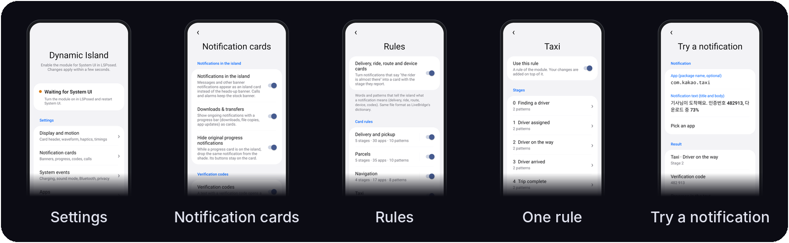

<p align="center">
  
</p>

<h3 align="center">make the status bar alive!</h3>

<p align="center">
  <b>A Dynamic Island for Samsung One UI.</b><br>
  A pill around the camera hole that opens into live cards for calls, music, navigation, timers and notifications.
</p>

<p align="center">
  <a href="https://github.com/sampple-korea/dynamicisland/releases/latest"></a>
  
  
  <a href="LICENSE"></a>
</p>

<p align="center">
  <a href="https://github.com/sampple-korea/dynamicisland/releases/latest"></a>
</p>

<p align="center">
  <b>English</b> · <a href="README.ko.md">한국어</a> · <a href="#features">Features</a> · <a href="#install">Install</a>
</p>

### Everything the capsule shows, as cards

The pill sits where the stock Now Bar capsule was and opens into cards.

<p align="center">
  
</p>

Dynamic Island replaces Samsung's Now Bar capsule in the status bar with a pill that grows into cards. Everything One UI keeps in the capsule (calls, timers, screen recording, casting, navigation, a music player) becomes a card, and so do ordinary notifications: messages, verification codes, downloads and the delivery, ride and route updates that apps only write as text. It is an LSPosed module that runs inside System UI, with a One UI style settings app and a rule manager. Inspired by [@cryyear's DynamicIsland](https://github.com/Spottq); this is a new implementation.

## Screenshots

<p align="center">
  
</p>

<p align="center">
  
</p>

These pictures are drawn by the app's own drawing code on a mock phone in the test environment (see `scripts/readme_images.py`); they are not photos of a device, and the app icons are made of plain shapes.

## Features

- **Live notifications as cards:** Every System UI ongoing activity gets a compact pill and an expanded card: header, chronometer, description, plain / segmented / indeterminate progress, icon or text buttons, custom chip views, work profile badge. Calls, cast, screen recording, timers and a music player (seek bar, art-tinted glow, waveform, output route) are included.
- **Ordinary notifications as cards:**
  - Messages and banners open as an island card instead of the stock heads-up banner (calls and alarms keep the stock banner).
  - Verification codes get a card with a Copy button (optional auto-copy, marked sensitive).
  - Downloads, copies and updates become progress cards, including progress written only as text ("73%", "12 MB / 40 MB"). The original shade row can be hidden while the card is shown.
  - Voice-chat and VoIP calls get a call card with the running time and an end button.
- **Rules as data:** Delivery, pickup, parcel, ride, route, wearable and battery cards come from a rule file in LiveBridge's dictionary format. The module ships a Korean rule file (built from a year and a half of recorded notifications) and an English one; nothing is downloaded and the module has no network permission. Add your own rules from the clipboard.
- **System events:** Charging, low battery, sound mode, Bluetooth audio with battery, camera / microphone / location in use, and quick-setting feedback (Do Not Disturb, airplane, power saving, torch, hotspot, auto-rotate).
- **App control:** A blacklist or whitelist of apps for the ordinary-notification features. Live notifications, media, calls and system events are never filtered.
- **Motion:** Spring-based animations with squash and stretch, a liquid bridge between pill and card, and cards that grow out of the pill.
- **One UI settings app:** A hub of grouped cards with sub pages, in Korean and English.
- **Safety:** A crash guard switches the module off after repeated System UI crashes, hook groups are isolated, and a diagnostics page shows what the module did inside System UI.

## Features in detail

### The island itself

- **Pill and cards.** A compact black pill sits around the camera hole and grows out of it. Tap it to open the cards; each card shows the app, what is happening and its buttons. Several things at once are stacked in order of importance (calls first, then heads-up cards, navigation, recording, timers, events, live notifications, tasks, music, charging).
- **Gestures.** Press and tap the pill to open it, swipe it sideways to cycle between items, swipe an item away to put it aside in a small bubble (tap the bubble to bring it back), drag the open cards (they follow your finger like a rubber band; sideways moves one card), tap a card to open its app, press its buttons, scrub the seek bar of the music card, and drag the pill down to pull the notification shade (the drag is replayed into System UI).
- **Folds itself away.** An opened island closes after a time you choose, and a paused player leaves after a time you choose.
- **Stays out of the way.** It hides on the lock screen and the always-on display, in full-screen apps, and on phones in landscape (tablets keep it). After unlocking it waits briefly before it appears. Items of the app you are currently using are held back and fly in once you leave that app.
- **Takes over cleanly.** Samsung's own ongoing-activity chip, its animations and the status bar icons and clock under the pill are faded out or kept hidden, and the island puts the same information in one place. Duplicates of the same notification (for example the LiveBridge app's copies) are not shown twice.
- **Looks like it belongs.** Frosted glass behind the cards (Samsung's blur), colours taken from the app icon or the album art, white-glyph avatars swapped for the app icon on a dark disc so they stay readable, work profile badges, the system font, and haptic ticks when it opens, closes and when you press a button (can be switched off).
- **Motion.** Every movement is a spring with its own feel: the pill drops in and bounces once, squashes and stretches when it changes size, pours into its cards and swells back, and cards leave by being drawn back up. Between pill and card a liquid bridge thins like an hourglass, pinches off and snaps back with a small wobble, and merges again when they meet. Pressing a button gives a press effect on that card only.

### Live notifications (Samsung ongoing activities)

- Everything that One UI shows in its Now Bar capsule becomes a card: app header with time, title, secondary line and icon, description, chronometer (counting up or down, in the primary or secondary position), plain, segmented (with marker icon) and indeterminate progress bars, round icon buttons or text buttons with per-action colours, custom chip views from the app, and a work profile badge.
- **Android 16 ProgressStyle:** coloured segments (elapsed and remaining), milestone points and the tracker icon.
- **Calls:** caller, running time, mute / speaker / hang-up buttons, from the system call chip.
- **Timers and stopwatches** with rolling digits (and hundredths for stopwatches), **screen recording**, **casting**, **navigation**.
- **Music player:** seek bar, play / pause / previous / next, album art kept in its aspect ratio, a glow tinted from the art that follows the card's shape, a waveform that is driven by the real audio output (or a gentle animation if you prefer), and a label for where the sound goes (Bluetooth device with its battery, wired headset, cast target).

### Ordinary notifications as cards

- **Messages and banners** open as an island card (sender, message, app icon or avatar, the notification's own buttons, tap to open) instead of the heads-up banner. Calls, alarms and full-screen notifications keep the stock banner. The notification itself stays in the shade and keeps its sound.
- **Verification codes:** a text with a code opens a card with the code, a Copy button and optionally copies it at once (marked sensitive so the clipboard preview hides it). Detection scores trigger words and their distance to the code and rejects phone numbers, prices, order numbers and adverts; a code that arrives twice (re-posted, or mirrored by another app) shows one card.
- **Downloads, file copies, uploads and app updates:** progress cards with the bar and the buttons of the notification, also for apps that never opted in to One UI's live notifications. Progress written only as text ("Downloading 73 %", "12.4 MB / 40 MB") is understood too. The original row in the shade can be hidden while its card is shown.
- **Voice-chat and VoIP calls** (KakaoTalk voice call, Discord voice and similar) get the call card with the running time and an end button.
- Which apps are turned into cards can be limited with a blacklist or a whitelist.

### Cards from rules

- A **rule** turns a notification into a card with stages: for example *ordered, cooking, on the way, almost there, delivered*. The module ships a Korean rule file built from a year and a half of recorded notifications:
  - **Delivery and pickup:** Coupang Eats, Baemin, Yogiyo, Pass order, Starbucks, Subway, Lotteria, McDonald's.
  - **Parcels:** Smart Parcel (CJ and others), Coupang, Kream, AliExpress, Kurly, Gmarket, 11st and the carriers' own apps.
  - **Navigation:** Naver Map, T map, Kakao Map, Kimgisa and Google Maps (walking, riding, getting off, arrival, with the distance on the pill).
  - **Taxi:** Kakao T, T map taxi, Uber, Onda (calling, assigned, approaching, riding, arrived).
  - **Wearables and earbuds:** Galaxy Ring, Watch and Buds connection and disconnection (repeats are held back by a cooldown), fully charged, and low-battery percentages.
  - **Device connection:** the name of the Bluetooth or accessory device that just connected.
  - A list of mail, chat, social and news apps that never make a card.
- The **English rules** are written for this project from how English-language apps word their notifications; no LiveBridge file is copied. They cover:
  - **Food delivery:** DoorDash, Uber Eats, Grubhub, Postmates, Instacart, Domino's, Pizza Hut, Starbucks, Chipotle, Deliveroo, Just Eat, Wolt, Glovo and others (order placed, preparing, on the way, arriving, delivered).
  - **Parcels:** Amazon, UPS, FedEx, USPS, DHL, Royal Mail, Shop, Evri, Canada Post, Australia Post and others (label created, in transit, at the local facility, out for delivery, delivered).
  - **Ride hailing:** Uber, Lyft, Bolt, Grab, Ola, DiDi, FREE NOW, Cabify, inDrive (finding a driver, driver assigned, on the way, arrived, trip complete).
  - **Navigation:** Google Maps, Waze, Citymapper, HERE, TomTom, MapQuest and others (turns with the distance in miles, feet or kilometres, getting off, arrival).
  - **Accessories:** connection, disconnection, fully charged and low-battery percentages for Pixel Buds, Fitbit, Garmin, Galaxy Wearable and other accessory apps.
  - Chat, mail, social, video and news apps are left out. Stage names follow the phone's language: English on English phones, Korean on Korean ones.
- The **English rules** are written for this project from how English-language apps word their notifications; no LiveBridge file is copied. They cover:
  - **Food delivery:** DoorDash, Uber Eats, Grubhub, Postmates, Instacart, Domino's, Pizza Hut, Starbucks, Chipotle, Deliveroo, Just Eat, Wolt, Glovo and others (order placed, preparing, on the way, arriving, delivered).
  - **Parcels:** Amazon, UPS, FedEx, USPS, DHL, Royal Mail, Shop, Evri, Canada Post, Australia Post and others (label created, in transit, at the local facility, out for delivery, delivered).
  - **Ride hailing:** Uber, Lyft, Bolt, Grab, Ola, DiDi, FREE NOW, Cabify, inDrive (finding a driver, driver assigned, on the way, arrived, trip complete).
  - **Navigation:** Google Maps, Waze, Citymapper, HERE, TomTom, MapQuest and others (turns with the distance in miles, feet or kilometres, getting off, arrival).
  - **Accessories:** connection, disconnection, fully charged and low-battery percentages for Pixel Buds, Fitbit, Garmin, Galaxy Wearable and other accessory apps.
  - Chat, mail, social, video and news apps are left out. Stage names follow the phone's language: English on English phones, Korean on Korean ones.
- Cards of finished processes leave after a few minutes, the others after hours; events that repeat all day are shown once per cooldown; a signal can carry a percentage that becomes the card's progress.
- Rule files use the format of LiveBridge's dictionary. Patterns that could hang the phone (runaway regular expressions) are refused when a file is read, and very long texts are cut before matching.

### Rule manager

- A **switch for every rule**, a list showing its stages, apps and patterns, and a detail page for each rule.
- **Add to the module's rules without touching them:** name a stage, add a pattern to it, add more stages (up to nine), add an app (from your installed apps) or an excluded wording; undo all your changes of a rule in one tap.
- **Make a new rule** for an app or a wording of your own.
- **Try a notification:** type an app and a text and see at once which rule fires and at which stage, whether it would be read as a verification code, and what progress it holds.
- **Import / export** your rules as JSON through the clipboard; reset everything.

### System events

- **Charging** (fast or wireless, with the live percentage), **low battery**, **sound mode** (silent, vibrate, ring), **Bluetooth audio** connecting (with its battery level).
- **Camera, microphone and location in use:** which app uses which sensor; a tap opens that app's permission page. (Location is off by default because navigation and weather apps use it all day.)
- **Quick-setting feedback:** Do Not Disturb, airplane mode, power saving, hotspot and auto-rotate being switched on or off.
- **Flashlight brightness:** While the torch is on, tapping the island opens a card with a big iOS style slider for its brightness levels (5 on Galaxy phones, read from the camera) and a turn-off button. On a phone whose torch has a single level the plain "flashlight on" popup is shown instead.
- Every group can be switched off separately.

### Settings app

- A One UI style hub with grouped cards and sub pages: **Display and motion**, **Notification cards**, **System events**, **App control**, **Rules** and **Tools** (restart System UI with root, diagnostics), in Korean and English, light and dark. Changes apply within a few seconds without a reboot.
- **Island position and size:** put the island on the camera hole (default), in the middle, or on the left or right of the status bar, and shift it sideways or up and down. The island on the real status bar moves while you drag the sliders. The **camera hole** can be found automatically, set by hand (size and place, shown as a blue ring on the real screen) or turned off. Text inside the pill keeps away from the hole. The pill's height, narrowest and widest width can be set too (and it can keep its widest width), with the same live preview.
- Four kinds of settings: switches, values that open a choice, links to sub pages and actions. A switch that is off dims what depends on it.

### Reliability

- Hooks are installed in **isolated groups**: one that cannot attach to your System UI build does not take the others down. Every hook body and every data source is contained, so a failure becomes a log line instead of a System UI crash.
- A **crash guard** switches the module off after repeated System UI crashes or unstable starts, forgets that verdict after a system update or twelve hours, and keeps the cause of the last crash.
- A **diagnostics page** shows the System UI version, the start-up stages, hooks that did not attach, recent errors and the previous crash, ready to copy into an issue.
- If System UI never reports its status bar, the island creates its window by itself after fifteen seconds.
- The app has **no network permission** and no data leaves the phone.

## Requirements

- A Samsung device on One UI 7 / 8 / 9 (Android 15 / 16 / 17) with the stock System UI. One UI 7 support is new and checked against one System UI build only (see [docs/COMPATIBILITY.md](docs/COMPATIBILITY.md)).
- LSPosed (module minimum SDK 35).
- Root is only needed for the optional **Restart System UI** button.

## Install

1. Install a signed Dynamic Island APK from the project's **Releases**, if available. Otherwise, build it from source (below).
2. In LSPosed, enable **Dynamic Island** and set its scope to **System UI** (`com.android.systemui`).
3. Restart System UI (the app's **Restart System UI** button, or reboot).
4. Open Dynamic Island from the launcher. Changes apply within a few seconds, no restart needed.

## Settings

| Page | What it holds |
|---|---|
| Island position and size | Where the island sits, shift, height, narrowest and widest width, camera hole (automatic, by hand or none) |
| Display and motion | Card header, audio waveform, haptics, auto-collapse and paused-music timers |
| Notification cards | Notifications in the island, progress cards, verification codes, voice-chat calls |
| System events | Charging, sound mode, Bluetooth, setting changes, privacy indicators |
| App control | Blacklist / whitelist and the app list |
| Rules | A switch per card rule, stages, apps and wording of each rule (add your own), a tester that shows what a notification text becomes, import / export |
| Tools | Restart System UI, diagnostics |

## If it does not work

Open **Tools → Diagnostics** in the app after restarting System UI. It lists the System UI version, the start-up stages, hooks that could not attach, errors and the previous crash. Use **Copy report** and send it with the issue.

## Build from source

Requires JDK 17+ and the Android SDK (compile SDK 36).

```bash
./gradlew assembleRelease     # unsigned APK in app/build/outputs/apk/release
KEYSTORE_PASSWORD=... scripts/sign.sh   # builds, aligns and signs -> release/DynamicIsland-<version>.apk
./gradlew testReleaseUnitTest # unit tests and headless render tests
```

`scripts/sign.sh` takes the keystore password from `KEYSTORE_PASSWORD` and creates a self-signed key in `release-keys/` on first run (git-ignored). Keep it: updates must be signed with the same key. See [`docs/DEVELOPMENT.md`](docs/DEVELOPMENT.md) for the source layout, hook notes, rules format and test setup.

## Releases

Signed APKs are published on the [Releases](../../releases) page; the build is automated (see [`docs/DEVELOPMENT.md`](docs/DEVELOPMENT.md)). Every release is signed with the same key, so a new version installs as an update over the old one.

## Privacy

The module runs inside System UI and reads the notifications System UI already holds. It has no network permission and sends nothing anywhere. Settings and the diagnostics report stay on the device; the report holds no notification text.

## Disclaimer

Dynamic Island is an independent, unofficial project and is not affiliated with or endorsed by Samsung. It hooks private System UI classes that may change with any update, and it has been verified only in a headless test and render environment, not on a device. Use it at your own risk.

## Credits

- [LiveBridge](https://github.com/appsfolder/livebridge) — the rule file format this project reads (no LiveBridge files are bundled)
- @cryyear's DynamicIsland ([github.com/Spottq](https://github.com/Spottq)), which inspired this project; the code here is a new implementation
- [Xposed API](https://api.xposed.info/) (Apache-2.0, `app/libs/xposed-api-82.jar`) and [LSPosed](https://github.com/LSPosed/LSPosed)

## License

[MIT](LICENSE) © 2026 sampple-korea.

## Made by [sampple-korea](https://github.com/sampple-korea)
