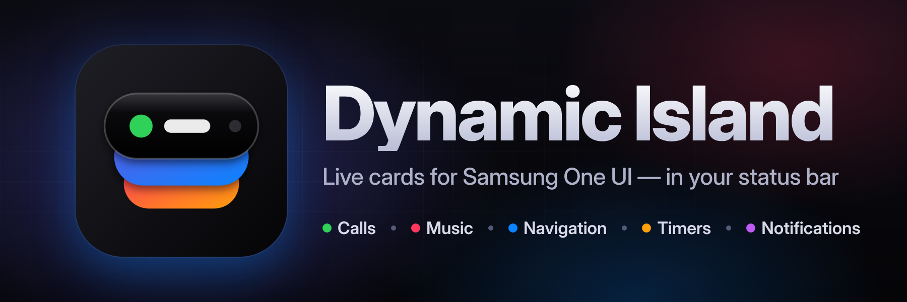
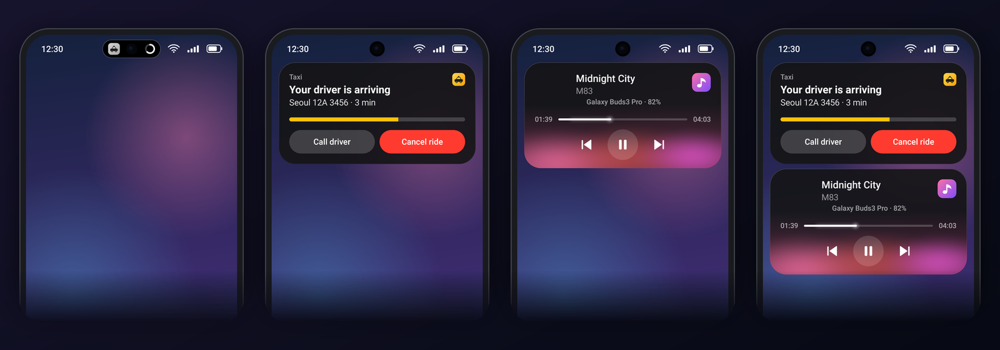
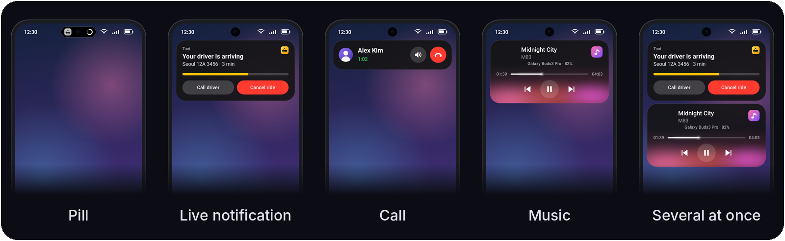
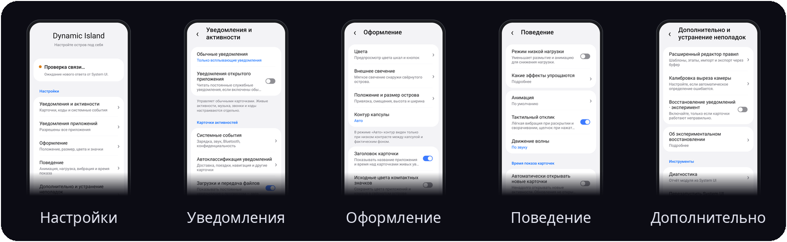

<p align="center">
  
</p>

<h3 align="center">оживите строку состояния!</h3>

<p align="center">
  <b>Dynamic Island для Samsung One UI.</b><br>
  Таблетка вокруг выреза камеры, которая раскрывается в живые карточки звонков, музыки, навигации, таймеров и уведомлений.
</p>

<p align="center">
  <a href="https://github.com/sampple-korea/dynamicisland/releases/latest"></a>
  
  
  <a href="LICENSE"></a>
</p>

<p align="center">
  <a href="https://github.com/sampple-korea/dynamicisland/releases/latest"></a>
  <a href="https://apps.obtainium.imranr.dev/redirect?r=obtainium://add/https://github.com/sampple-korea/dynamicisland"></a>
</p>

<p align="center">
  <a href="README.md">English</a> · <a href="README.ko.md">한국어</a> · <a href="README.ja.md">日本語</a> · <a href="README.zh.md">中文</a> · <b>Русский</b> · <a href="README.tr.md">Türkçe</a> · <a href="#возможности">Возможности</a> · <a href="#установка">Установка</a>
</p>

### Всё, что показывает капсула, — в виде карточек

Таблетка находится там, где была штатная капсула Now Bar, и раскрывается в карточки.

<p align="center">
  
</p>

Dynamic Island заменяет капсулу Now Bar от Samsung в строке состояния таблеткой, которая вырастает в карточки. Всё, что One UI держит в капсуле (звонки, таймеры, запись экрана, трансляция, навигация, музыкальный плеер), становится карточкой — как и обычные уведомления: сообщения, коды подтверждения, загрузки, а также обновления доставки, поездок и маршрутов, которые приложения пишут только текстом. Это модуль LSPosed, который работает внутри System UI, с приложением настроек в стиле One UI и менеджером правил.

## Скриншоты

<p align="center">
  
</p>

<p align="center">
  
</p>

Эти картинки нарисованы кодом самого приложения на макете телефона в тестовой среде (см. `scripts/readme_images.py`); это не фотографии устройства, а значки приложений составлены из простых фигур.

## Новое в 0.1.13

Стабильная версия объединяет изменения тестовых сборок 0.1.13: общее свечение под музыку, упрощённые настройки, необязательные карточки зарядки и наушников, исправления времени записи экрана, системного шрифта и сбоя при долгом нажатии на живое уведомление. Добавлены круговые индикаторы заряда и более ясная компактная информация. Радиус углов карточек по умолчанию — 28dp, по желанию — 0–48dp. Экспериментальная волна Samsung Диктофона по умолчанию выключена; включайте её в расширенных настройках с учётом совместимости устройства.

[Описание выпуска](docs/release-notes/0.1.13.md) · [36 примеров карточек](docs/cards-overview-0.1.13.png) (примерные данные, включая необязательные функции).

## Возможности

- **Живые уведомления в виде карточек:** каждая текущая активность System UI получает компактную таблетку и раскрытую карточку: заголовок, секундомер, описание, обычный / сегментированный / неопределённый индикатор прогресса, кнопки с значками или текстом, особые чип-виды, значок рабочего профиля. Звонки, трансляция, запись экрана, таймеры и музыкальный плеер (полоса перемотки, свечение по цвету обложки, волна, маршрут вывода звука) включены.
- **Обычные уведомления в виде карточек:**
  - Сообщения и баннеры открываются карточкой острова вместо штатного всплывающего баннера (у звонков и будильников остаётся штатный баннер).
  - Коды подтверждения получают карточку с кнопкой «Копировать» (по желанию — автокопирование, помечается как конфиденциальное).
  - Загрузки, копирования и обновления становятся карточками прогресса, в том числе когда прогресс написан только текстом («73%», «12 МБ / 40 МБ»). Пока показана карточка, исходную строку в шторке можно скрыть.
  - Голосовые чаты и VoIP-звонки получают карточку звонка со временем разговора и кнопкой завершения.
- **Правила как данные:** карточки доставки, самовывоза, посылок, поездок, маршрутов, носимых устройств и батареи берутся из файла правил в формате словаря LiveBridge. В модуле есть корейский файл правил (собранный из полутора лет записанных уведомлений) и английский; ничего не скачивается, у модуля нет разрешения на сеть. Свои правила можно добавить из буфера обмена.
- **Системные события:** зарядка, низкий заряд, режим звука, Bluetooth-аудио с зарядом, использование камеры / микрофона / геолокации и отклик быстрых настроек («Не беспокоить», режим полёта, энергосбережение, фонарик, точка доступа, автоповорот).
- **Управление приложениями:** чёрный или белый список приложений для функций обычных уведомлений. Живые уведомления, медиа, звонки и системные события никогда не фильтруются.
- **Движение:** анимации на пружинах со сжатием и растяжением, жидкий мостик между таблеткой и карточкой, карточки, вырастающие из таблетки.
- **Приложение настроек в стиле One UI:** центр из сгруппированных карточек с подстраницами, на английском, корейском, японском, китайском (упрощённом), русском и турецком.
- **Шесть языков:** настройки, текст острова и названия этапов используют общие строки Android с английским оригиналом. Текст уведомлений других приложений не меняется; встроенное распознавание остаётся корейским и английским. Как добавить язык без правки Java, описано в [руководстве по переводу](docs/TRANSLATING.md).
- **Безопасность:** защита от сбоев отключает модуль после повторных падений System UI, группы хуков изолированы, а страница диагностики показывает, что модуль делал внутри System UI.

## Возможности подробно

### Сам остров

- **Таблетка и карточки.** Компактная чёрная таблетка охватывает вырез камеры и вырастает из него. Нажмите на неё, чтобы открыть карточки; в каждой — приложение, что происходит и его кнопки. Несколько событий сразу складываются стопкой по важности (сначала звонки, затем всплывающие карточки, навигация, запись, таймеры, события, живые уведомления, задачи, музыка, зарядка).
- **Жесты.** Нажмите и коснитесь таблетки, чтобы открыть её; проведите вбок, чтобы перелистывать элементы; смахните элемент, чтобы убрать его в маленький пузырёк (коснитесь пузырька, чтобы вернуть); перетаскивайте открытые карточки (они тянутся за пальцем, как резинка; движение вбок сдвигает одну карточку); коснитесь карточки, чтобы открыть её приложение; нажимайте её кнопки; перематывайте полосу музыкальной карточки; потяните таблетку вниз, чтобы опустить шторку уведомлений (жест передаётся в System UI).
- **Сворачивается сам.** Открытый остров закрывается через выбранное вами время, а приостановленный плеер уходит через выбранное вами время.
- **Не мешает.** Скрывается на экране блокировки и в always-on-дисплее, в полноэкранных приложениях и на телефонах в альбомной ориентации (на планшетах остаётся). После разблокировки немного ждёт, прежде чем появиться. Элементы приложения, которым вы пользуетесь сейчас, придерживаются и влетают, когда вы покидаете это приложение. В разделе **Поведение → Показывать в портретном полноэкранном режиме** (по умолчанию выключено) можно сохранить отображение текущих активностей в камере и других портретных приложениях, скрывающих строку состояния. На экране блокировки, Always On Display и при отсутствии активностей остров по-прежнему скрывается.
- **Чисто берёт на себя.** Штатная капсула текущей активности Samsung, её анимации, а также значки строки состояния и часы под таблеткой скрываются или остаются скрытыми, а остров собирает ту же информацию в одном месте. Дубликаты одного уведомления (например, копии приложения LiveBridge) не показываются дважды.
- **Выглядит как родной.** Матовое стекло за карточками (размытие Samsung), цвета из значка приложения или обложки альбома, аватары с белыми глифами заменяются значком приложения на тёмном диске, чтобы оставаться читаемыми, значки рабочего профиля, системный шрифт и тактильный отклик при открытии, закрытии и нажатии кнопки (можно отключить).
- **Движение.** Каждое движение — пружина со своим характером: таблетка падает и один раз подпрыгивает, сжимается и растягивается при смене размера, перетекает в свои карточки и снова набухает, а карточки уходят, втягиваясь обратно вверх. Жидкий мостик между таблеткой и карточкой истончается, как песочные часы, перетягивается и со слабым колебанием схлопывается обратно, а при встрече снова сливается. Нажатие кнопки даёт эффект нажатия только на этой карточке.

### Живые уведомления (текущие активности Samsung)

- Всё, что One UI показывает в капсуле Now Bar, становится карточкой: заголовок приложения со временем, название, вторая строка и значок, описание, секундомер (вперёд или назад, в основной или дополнительной позиции), обычные, сегментированные (со значком-маркером) и неопределённые индикаторы прогресса, круглые кнопки со значками или текстовые кнопки с цветами для каждого действия, особые чип-виды из приложения и значок рабочего профиля.
- **Android 16 ProgressStyle:** цветные сегменты (пройдено и осталось), контрольные точки и значок трекера.
- **Звонки:** абонент, время разговора, кнопки «Выключить микрофон» / «Динамик» / «Завершить» — из системного чипа звонка.
- **Таймеры и секундомеры** с прокручивающимися цифрами (у секундомеров — и сотые доли), **запись экрана**, **трансляция**, **навигация**.
- **Музыкальный плеер:** полоса перемотки, воспроизведение / пауза / назад / вперёд, обложка с сохранением пропорций, свечение по цвету обложки, повторяющее форму карточки, волна, которая управляется реальным звуковым выводом (или плавная анимация, если вы предпочитаете), и подпись, куда идёт звук (Bluetooth-устройство с зарядом, проводная гарнитура, устройство трансляции).

### Обычные уведомления в виде карточек

- **Сообщения и баннеры** открываются карточкой острова (отправитель, сообщение, значок приложения или аватар, собственные кнопки уведомления, нажатие открывает) вместо всплывающего баннера. У звонков, будильников и полноэкранных уведомлений остаётся штатный баннер. Само уведомление остаётся в шторке и сохраняет звук.
- **Коды подтверждения:** текст с кодом открывает карточку с кодом и кнопкой «Копировать» и по желанию сразу копирует его (помечено как конфиденциальное, чтобы предпросмотр буфера обмена его скрывал). Обнаружение оценивает слова-триггеры и их расстояние до кода и отвергает номера телефонов, цены, номера заказов и рекламу; код, пришедший дважды (повторно отправленный или продублированный другим приложением), даёт одну карточку.
- **Загрузки, копирование файлов, выгрузки и обновления приложений:** карточки прогресса с полосой и кнопками уведомления, в том числе для приложений, которые не подключались к живым уведомлениям One UI. Прогресс, написанный только текстом («Загрузка 73 %», «12,4 МБ / 40 МБ»), тоже понимается. Пока показана карточка, исходную строку в шторке можно скрыть.
- **Голосовые чаты и VoIP-звонки** (голосовой звонок KakaoTalk, голос в Discord и подобное) получают карточку звонка со временем разговора и кнопкой завершения.
- Для каких приложений создаются карточки, можно ограничить чёрным или белым списком.

### Карточки по правилам

- **Правило** превращает уведомление в карточку с этапами: например, *заказ принят, готовится, в пути, почти на месте, доставлен*. В модуле есть корейский файл правил, собранный из полутора лет записанных уведомлений:
  - **Доставка и самовывоз:** Coupang Eats, Baemin, Yogiyo, Pass order, Starbucks, Subway, Lotteria, McDonald's.
  - **Посылки:** Smart Parcel (CJ и другие), Coupang, Kream, AliExpress, Kurly, Gmarket, 11st и собственные приложения перевозчиков.
  - **Навигация:** Naver Map, T map, Kakao Map, Kimgisa и Google Maps (пешком, на велосипеде, выход, прибытие, расстояние на таблетке).
  - **Такси:** Kakao T, такси T map, Uber, Onda (вызов, назначено, приближается, в пути, прибыло).
  - **Носимые устройства и наушники:** подключение и отключение Galaxy Ring, Watch и Buds (повторы сдерживаются паузой), полная зарядка и проценты низкого заряда.
  - **Подключение устройств:** название Bluetooth-устройства или аксессуара, которое только что подключилось.
  - Список почтовых, чат-, социальных и новостных приложений, которые никогда не создают карточку.
- **Английские правила** написаны для этого проекта по тому, как англоязычные приложения формулируют уведомления; ни один файл LiveBridge не скопирован. Они охватывают:
  - **Доставка еды:** DoorDash, Uber Eats, Grubhub, Postmates, Instacart, Domino's, Pizza Hut, Starbucks, Chipotle, Deliveroo, Just Eat, Wolt, Glovo и другие (заказ оформлен, готовится, в пути, скоро будет, доставлен).
  - **Посылки:** Amazon, UPS, FedEx, USPS, DHL, Royal Mail, Shop, Evri, Canada Post, Australia Post и другие (этикетка создана, в пути, в местном отделении, передана курьеру, доставлена).
  - **Вызов такси:** Uber, Lyft, Bolt, Grab, Ola, DiDi, FREE NOW, Cabify, inDrive (поиск водителя, водитель назначен, в пути, прибыл, поездка завершена).
  - **Навигация:** Google Maps, Waze, Citymapper, HERE, TomTom, MapQuest и другие (повороты с расстоянием в милях, футах или километрах, выход, прибытие).
  - **Аксессуары:** подключение, отключение, полная зарядка и проценты низкого заряда для Pixel Buds, Fitbit, Garmin, Galaxy Wearable и других приложений аксессуаров.
  - Чат-, почтовые, социальные, видео- и новостные приложения исключены. Названия этапов следуют языку телефона: английские на английских телефонах, корейские на корейских.
- Карточки завершённых процессов уходят через несколько минут, остальные — через часы; события, повторяющиеся весь день, показываются один раз за период паузы; сигнал может нести процент, который становится прогрессом карточки.
- Файлы правил используют формат словаря LiveBridge. Шаблоны, способные подвесить телефон (неуправляемые регулярные выражения), отклоняются при чтении файла, а очень длинные тексты обрезаются перед сопоставлением.

### Менеджер правил

- **Переключатель для каждого правила**, список с его этапами, приложениями и шаблонами и страница подробностей для каждого правила.
- **Дополнение правил модуля, не меняя их:** назовите этап, добавьте к нему шаблон, добавьте этапы (до девяти), добавьте приложение (из установленных) или исключаемую формулировку; все ваши изменения правила отменяются одним нажатием.
- **Создайте новое правило** для приложения или вашей собственной формулировки.
- **Проверка уведомления:** введите приложение и текст и сразу увидите, какое правило срабатывает и на каком этапе, будет ли текст прочитан как код подтверждения и какой прогресс он несёт.
- **Импорт / экспорт** ваших правил в JSON через буфер обмена; сброс всего.

### Системные события

- **Зарядка** (быстрая или беспроводная, с процентом в реальном времени), **низкий заряд**, **режим звука** (без звука, вибрация, звонок), подключение **Bluetooth-аудио** (с уровнем заряда).
- **Дополнительные карточки устройства:** Подробности зарядки, статистика и уведомления о проводных/USB-наушниках по умолчанию выключены в разделе **Уведомления → Системные события**. Карточка зарядки сохраняет приоритет событий и заменяет краткий всплывающий индикатор, пока активна. Статистика требует включённой карточки; выключение каждой опции останавливает соответствующий сбор. Мощность оценивается на стороне батареи, а распределение изменения заряда по состоянию экрана приблизительное и основано на наблюдаемых интервалах. В **Дополнительных настройках → Калибровка камеры** доступен дополнительный отступ текста 0–16dp; 0 сохраняет исходный интервал.
- **Эффект зарядки батареи Samsung:** Опция **Уведомления → Системные события → Эффект зарядки батареи Samsung** по умолчанию выключена. Скрывается цветная анимация расширения батареи в строке состояния; обычный значок, процент, индикатор зарядки, звук и уведомления острова сохраняются. Обрабатываются проверенный путь Compose в One UI 9 и путь планировщика BatteryEvent при их наличии; неподдерживаемые сборки сохраняют исходное поведение.
- **Использование камеры, микрофона и геолокации:** какое приложение какой датчик использует; нажатие открывает страницу разрешений этого приложения. (Геолокация по умолчанию выключена, потому что навигация и погода используют её весь день.)
- **Отклик быстрых настроек:** включение и выключение режима «Не беспокоить», режима полёта, энергосбережения, точки доступа и автоповорота.
- **Яркость фонарика:** пока фонарик включён, нажатие на остров открывает карточку с большим ползунком в стиле iOS для уровней яркости (5 на телефонах Galaxy, считываются с камеры) и кнопкой выключения. На телефоне, у которого у фонарика один уровень яркости, у карточки нет ползунка, только состояние и кнопка выключения (если выключить переключатель *Карточка фонарика*, будет обычное всплывающее окно «Фонарик включён»).
- Каждую группу можно отключить отдельно.

### Приложение настроек

- **Внешнее свечение (включено по умолчанию, только при музыкальной сессии):** все компактные таблетки разделяют цвета и реакцию на звук музыкальной сессии, даже если сам плеер скрыт. Палитра альбома совпадает со звуковой волной. На паузе свечение тускнеет, а при завершении сессии плавно исчезает за 1,2 секунды с последними цветами. Можно выбрать музыку или все события, яркость (45%) и силу движения (0–100%, по умолчанию 50%) с предпросмотром. Цвет темы и отдельная палитра/HSV/HEX доступны. В режиме низкой нагрузки свечение отключено.
- **Режим низкой нагрузки (по умолчанию выключен):** размытие содержимого заменяется плавным переходом, фона — непрозрачной чёрной карточкой. Цвета альбома, обложка, волна и значки статичны, анализ звука остановлен; реальное состояние батареи обновляется. Постоянное движение ограничено 30 кадрами/с, касания и раскрытие/сворачивание — 60 кадрами/с. Личные настройки сохраняются и возвращаются после выключения. Уведомления, звонки, таймеры и управление музыкой работают.
- Шесть групп: **Уведомления и активности**, **Уведомления приложений**, **Оформление**, **Поведение**, **Дополнительно и устранение неполадок**, **О приложении**. Английский, корейский, японский, упрощённый китайский, русский и турецкий языки; светлая и тёмная темы. Большинство настроек применяются за несколько секунд без перезапуска System UI.
- **Положение и размер:** предпросмотр в настоящей строке состояния, автоматическая или своя ширина, ползунки, ввод чисел и шаговая регулировка. Положение, размер и калибровка камеры сбрасываются отдельно. Калибровка выреза находится в дополнительных настройках.
- **Уведомления и приложения:** обычные карточки можно отключить, оставить только всплывающие или включить беззвучные. Постоянные служебные уведомления по умолчанию исключены. Фильтр приложений касается только обычных карточек: поиск по имени или пакету, показ выбранных, сохранение или отмена.
- **Оформление и поведение:** стандартный или свой цвет, редактор HSV/HEX с отменой; большие значки событий по умолчанию, маленькие по выбору; значок батареи при зарядке по умолчанию скрыт. Предпросмотр анимации использует настоящий движок острова, выбор сохраняется сразу. Волна реагирует на звук или показывает демонстрацию.
- **Время и восстановление:** автоматическое открытие активностей по умолчанию выключено. Его время показа (4 секунды), сворачивание вручную открытых карточек (6 секунд) и хранение приостановленной музыки (60 секунд) настраиваются отдельно. Экспериментальное восстановление уведомлений предназначено для проблем совместимости и по умолчанию выключено.
- **Язык и состояние:** язык настроек выбирается в информации о приложении, карточки используют язык устройства. Проверка связи требует нового ответа System UI, а не старого отчёта. При возврате восстанавливается позиция прокрутки.

### Надёжность

- Хуки устанавливаются **изолированными группами**: группа, которая не может подключиться к вашей сборке System UI, не тянет за собой остальные. Каждое тело хука и каждый источник данных ограждены, поэтому сбой превращается в строку журнала, а не в падение System UI.
- **Защита от сбоев** отключает модуль после повторных падений System UI или нестабильных запусков, забывает этот вердикт после обновления системы или через двенадцать часов и сохраняет причину последнего сбоя.
- **Страница диагностики** показывает версию System UI, этапы запуска, хуки, которые не подключились, недавние ошибки и предыдущий сбой — готово для копирования в issue.
- Если System UI так и не сообщает о своей строке состояния, остров сам создаёт своё окно через пятнадцать секунд.
- У приложения **нет разрешения на сеть**, и никакие данные не покидают телефон.

## Требования

- Устройство Samsung с One UI 7 / 8 / 9 (Android 15 / 16 / 17) и штатным System UI. One UI 8 и 9 использовались на настоящих телефонах; поддержка One UI 7 новая и проверена только по одной сборке System UI, не на устройстве (см. [docs/COMPATIBILITY.md](docs/COMPATIBILITY.md)).
- LSPosed (минимальный SDK модуля — 35).
- Root нужен только для необязательной кнопки **Перезапустить System UI**.

## Установка

1. Установите подписанный APK Dynamic Island из раздела **Releases** проекта. Если его нет, соберите из исходников (ниже).
2. В LSPosed включите **Dynamic Island** и задайте область действия **System UI** (`com.android.systemui`).
3. Перезапустите System UI (кнопка **Перезапустить System UI** в приложении или перезагрузка).
4. Откройте Dynamic Island из лаунчера. Изменения применяются за несколько секунд, перезапуск не нужен.

## Настройки

| Страница | Содержание |
|---|---|
| Уведомления и активности | Обычные уведомления, системные события, автоклассификация, загрузки, звонки и коды |
| Уведомления приложений | Все, кроме выбранных / только выбранные; поиск; только обычные карточки |
| Оформление | Цвет, положение, размер, заголовки, значки, батарея при зарядке и музыка в шторке |
| Поведение | Стандартная / классическая анимация, вибрация, звуковая / демонстрационная волна, отдельные таймеры |
| Дополнительно и устранение неполадок | Шаблоны и этапы правил, импорт/экспорт через буфер, камера, экспериментальное восстановление, диагностика и перезапуск System UI |
| О приложении | Язык настроек, версия, автор и благодарности |

## Если не работает

Откройте в приложении **Дополнительно и устранение неполадок → Диагностика** после перезапуска System UI. Там перечислены версия System UI, этапы запуска, хуки, которые не удалось подключить, ошибки и предыдущий сбой. Нажмите **Копировать отчёт** и отправьте его вместе с issue.

## Сборка из исходников

Нужны JDK 17+ и Android SDK (compile SDK 36).

```bash
./gradlew assembleRelease     # неподписанный APK в app/build/outputs/apk/release
KEYSTORE_PASSWORD=... scripts/sign.sh   # собирает, выравнивает и подписывает -> release/DynamicIsland-<version>.apk
./gradlew testReleaseUnitTest # модульные тесты и безголовые тесты отрисовки
./gradlew testReleaseUnitTest -Prender # по желанию: PNG для визуальной проверки
```

`scripts/sign.sh` берёт пароль хранилища ключей из `KEYSTORE_PASSWORD` и при первом запуске создаёт самоподписанный ключ в `release-keys/` (в git не попадает). Сохраните его: обновления нужно подписывать тем же ключом. Структура исходников, заметки о хуках, формат правил и настройка тестов — в [`docs/DEVELOPMENT.md`](docs/DEVELOPMENT.md).

## Релизы

README описывает текущий исходный код; изменения, ожидающие выпуска, могут отсутствовать в последнем стабильном APK.

Подписанные APK публикуются на странице [Releases](../../releases); сборка автоматизирована (см. [`docs/DEVELOPMENT.md`](docs/DEVELOPMENT.md)). Каждый релиз подписан одним и тем же ключом, поэтому новая версия устанавливается как обновление поверх старой.

## Конфиденциальность

Модуль работает внутри System UI и читает уведомления, которые System UI уже хранит. У него нет разрешения на сеть, и он никуда ничего не отправляет. Настройки и отчёт диагностики остаются на устройстве; в отчёте нет текста уведомлений.

Необязательная волна микрофона вычисляет громкость из коротких буферов в памяти. По умолчанию выключена; звук не сохраняется и не передаётся.

## Отказ от ответственности

Dynamic Island — независимый неофициальный проект, он не связан с Samsung и не одобрен ею. Он подключает хуки к закрытым классам System UI, которые могут измениться при любом обновлении; проект использовался на настоящих телефонах с One UI 8 и 9, а One UI 7 и Nothing OS на устройстве не подтверждены (см. [docs/COMPATIBILITY.md](docs/COMPATIBILITY.md)). Используйте на свой риск.

## Лицензия

[MIT](LICENSE) © 2026 sampple-korea.

## Автор [sampple-korea](https://github.com/sampple-korea)

## Благодарности

- [LiveBridge](https://github.com/appsfolder/livebridge) — формат файла правил, который читает этот проект (файлы LiveBridge не включены)
- [Xposed API](https://api.xposed.info/) (Apache-2.0, `app/libs/xposed-api-82.jar`) и [LSPosed](https://github.com/LSPosed/LSPosed)
* DynamicIsland от @cryyear — Проект начался с модификации APK этого модуля, но позже был реализован заново с собственной кодовой базой и архитектурой. Сейчас он разрабатывается и поддерживается независимо.
- [@UnkilBonki](https://t.me/UnkilBonki) в Telegram — исправление ошибок, тестирование и помощь.
