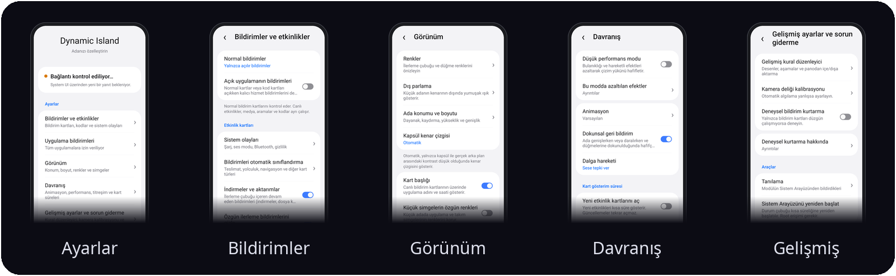

<p align="center">
  
</p>

<h3 align="center">durum çubuğuna hayat verin!</h3>

<p align="center">
  <b>Samsung One UI için Dynamic Island.</b><br>
  Kamera deliğinin çevresinde aramalar, müzik, navigasyon, zamanlayıcılar ve bildirimler için canlı kartlara açılan bir kapsül.
</p>

<p align="center">
  <a href="https://github.com/sampple-korea/dynamicisland/releases/latest"></a>
  
  
  <a href="LICENSE"></a>
</p>

<p align="center">
  <a href="https://github.com/sampple-korea/dynamicisland/releases/latest">APK indir</a> ·
  <a href="https://apps.obtainium.imranr.dev/redirect?r=obtainium://add/https://github.com/sampple-korea/dynamicisland">Obtainium ile edin</a>
</p>

<p align="center">
  <a href="README.md">English</a> · <a href="README.ko.md">한국어</a> · <a href="README.ja.md">日本語</a> · <a href="README.zh.md">中文</a> · <a href="README.ru.md">Русский</a> · <b>Türkçe</b> · <a href="#özellikler">Özellikler</a> · <a href="#kurulum">Kurulum</a>
</p>

### Kapsülün gösterdiği her şey, kart olarak

Dynamic Island, Samsung durum çubuğundaki Now Bar kapsülünü kartlara açılan bir adaya dönüştürür. One UI kapsülündeki aramalar, zamanlayıcılar, ekran kaydı, ekran aktarımı, navigasyon ve müzik ile normal bildirimlerdeki mesajlar, doğrulama kodları, indirmeler, teslimat ve yolculuk güncellemeleri kartlara dönüşür. System UI içinde çalışan bir LSPosed modülüdür; One UI tarzında ayarlar uygulaması ve kural yöneticisi içerir.

## Ekran görüntüleri

<p align="center">
  
  
</p>

Bu görseller uygulamanın gerçek çizim koduyla test ortamında oluşturulmuştur; cihaz fotoğrafı değildir. Uygulama simgeleri basit şekillerle temsil edilir.

## 0.1.13 yenilikleri

Bu kararlı sürüm, 0.1.13 geliştirme sürümlerini birleştirir: müziğe tepki veren ortak parlama, sade ayarlar, isteğe bağlı şarj ve kulaklık kartları, ekran kaydı süresi ve sistem yazı tipi düzeltmeleri ile canlı bildirime uzun basma çökmesi düzeltmesi. Dairesel pil göstergeleri ve küçük kapsül bilgileri iyileştirildi. Kart köşe yarıçapı varsayılan olarak 28dp, isteğe bağlı olarak 0–48dp olur. Samsung Ses Kaydedici için deneysel dalga varsayılan olarak kapalıdır; cihaz desteğine göre gelişmiş ayarlardan açılabilir.

[Sürüm notları](docs/release-notes/0.1.13.md) · [36 güncel kart örneği](docs/cards-overview-0.1.13.png) (isteğe bağlı özellikler dahil örnek veriler).

## Özellikler

- **Canlı kartlar:** Samsung devam eden etkinlikleri, aramalar, müzik, zamanlayıcılar, kayıt, aktarım ve navigasyon.
- **Normal bildirimler:** mesajlar, doğrulama kodları, indirmeler ve metinden sınıflandırılan teslimat veya yolculuk bilgileri.
- **Etkileşim:** kartı açma, kaydırarak değiştirme, küçültme, eylem düğmeleri, medya arama çubuğu ve ses çıkışı seçimi.
- **Sistem olayları:** şarj, düşük pil, ses modu, Bluetooth, hızlı ayar değişiklikleri ve gizlilik göstergeleri.
- **El feneri:** desteklenen cihazlarda parlaklık kaydırıcısı ve kapatma düğmesi.
- **Özelleştirme:** konum, boyut, kamera deliği, vurgu rengi, simgeler, animasyon ve kart süreleri.
- **Altı dil:** İngilizce, Korece, Japonca, Basitleştirilmiş Çince, Rusça ve Türkçe. Açık ve koyu tema.
- **Çevrimdışı:** ağ izni yoktur; veriler cihazdan çıkmaz.

## Ayrıntılı özellikler

### Adanın davranışı

- Dar kapsüle dokunarak kartları açın. Birden fazla etkinlik varsa kaydırarak aralarında geçiş yapın.
- Varsayılan animasyon, klasik animasyon seçeneği, titreşim ve geçiş sırasında içerik bulanıklığı bulunur. Hızlı açma ve kapatmalarda içerik geçişi korunur.
- Müzik başlığı, sanatçı, albüm görseli, oynatma denetimleri, ilerleme ve çıkış cihazı gösterilir. Özel medya eylemleri özgün simge oranını korur; ses kayıt oturumları müzik kartı olarak alınmaz.
- Arama, zamanlayıcı, ekran kaydı, navigasyon ve diğer canlı etkinlikler kaynak verilerine göre gösterilir.
- Bildirim paneli açılırken ada kademeli gizlenir. Desteklenen cihazlarda yerel arka plan bulanıklığı kullanılır; diğerlerinde düz arka plan bulunur.

**Davranış → Dikey tam ekranda göster** (varsayılan olarak kapalı) seçeneğiyle Kamera gibi durum çubuğunu gizleyen dikey uygulamalarda etkin içerik görünür kalabilir. Kilit ekranında, Always On Display sırasında veya etkin içerik olmadığında ada gizlenmeye devam eder.

### Canlı bildirimler

Samsung devam eden etkinliklerinin başlığı, metni, görselleri, ilerlemesi ve eylemleri kartlara aktarılır. Uygulama logolarının ayrıntıları korunur. Kartın desteklediği eylemler asıl uygulamaya gönderilir. Destek, cihazdaki System UI sürümüne bağlıdır.

### Normal bildirimler ve kodlar

- Normal bildirim kartları kapatılabilir, yalnızca açılır bildirimler gösterilebilir veya sessiz bildirimler de dahil edilebilir.
- Kalıcı hizmet bildirimleri isteğe bağlıdır ve varsayılan olarak alınmaz.
- Doğrulama kodları ayrı denetlenir. Otomatik kopyalama isteğe bağlıdır; varsayılan olarak kapalıdır.
- İndirme ve aktarım ilerlemesi ayrı denetlenir. Kart gösterildiğinde özgün bildirimi gizleme seçeneği bulunur.
- Uygulama filtresi yalnızca normal bildirim kartlarını kapsar; canlı etkinlikler, müzik, aramalar, kodlar ve sistem olayları ayrı çalışır.

### Kurallardan oluşturulan kartlar

Yerleşik kurallar teslimat, kargo, navigasyon, taksi, giyilebilir cihaz, pil, harici cihaz, VPN, aktarım ve asistan bildirimlerini sınıflandırabilir. Sonuç, uygulamanın bildirim metnine ve diline bağlıdır; her uygulama için garanti edilmez.

- Otomatik sınıflandırma sayfasında kart türlerini ayrı ayrı açıp kapatın.
- Gelişmiş düzenleyicide uygulama ipuçlarını, metin desenlerini, aşamaları ve süreleri değiştirin veya kural ekleyin.
- Bildirim denemesi, paket adı ve metin verildiğinde eşleşen kuralı, kodları ve ilerlemeyi gösterir.
- Özel kurallar JSON biçiminde panodan içe veya dışa aktarılır. İngilizce ana çeviri dosyası ve katkı yönergeleri: [docs/TRANSLATING.md](docs/TRANSLATING.md).

### Sistem olayları

- **Şarj:** hızlı veya kablosuz şarj ve güncel yüzde; pil simgesi varsayılan olarak gizlidir.
- **İsteğe bağlı cihaz kartları:** **Bildirimler → Sistem olayları** bölümündeki ayrıntılı şarj kartı, şarj istatistikleri ve kablolu/USB kulaklık bildirimleri varsayılan olarak kapalıdır. Şarj kartı olay önceliğini korur ve etkinken kısa şarj açılır bildirimini değiştirir. İstatistikler şarj kartını gerektirir; her seçeneği kapatmak ilgili toplamayı durdurur. Güç pil tarafında tahmin edilir; ekran durumuna göre şarj değişimi gözlenen aralıklara dayalı bir tahmindir. **Gelişmiş ayarlar → Kamera kalibrasyonu** bölümünde 0–16dp ek metin boşluğu ayarlanabilir; 0 özgün aralığı korur.
- **Samsung pil şarj efekti:** **Bildirimler → Sistem olayları → Samsung pil şarj efektini göster** varsayılan olarak kapalıdır. Durum çubuğundaki pilin genişleyerek renk değiştirdiği efekt gizlenir; normal pil simgesi, yüzde, şarj göstergesi, ses ve ada bildirimleri korunur. Varsa incelenen One UI 9 Compose yolu ve BatteryEvent zamanlayıcı yolu işlenir; desteklenmeyen sürümler özgün davranışını korur.
- **Pil ve bağlantılar:** düşük pil, ses modu ve Bluetooth ses cihazının bağlantısı; varsa cihazın pil bilgisi.
- **Gizlilik:** kamera ve mikrofon kullanımını gösterir. Konum göstergesi ayrıca açılır ve varsayılan olarak kapalıdır. Ana anahtar bu göstergelerin tümünü kontrol eder.
- **Hızlı ayarlar:** Rahatsız Etmeyin, uçak modu, güç tasarrufu, erişim noktası ve otomatik döndürme değişiklikleri.
- **El feneri:** açıkken adaya dokunarak parlaklık ve kapatma kartını açın. Parlaklık desteği ve adım sayısı kameradan okunur; tek seviyeli cihazlarda kaydırıcı gösterilmez. Kart kapatılırsa kısa bir durum bildirimi kullanılır.

### Ayarlar uygulaması

- **Dış parlama (varsayılan açık, yalnızca müzik oturumlarında):** müzik kapsülü gizliyken bile tüm küçük kapsüller müzik oturumunun renklerini ve sese tepkisini paylaşır. Albüm eşleştirmesi dalga renklerini kullanır. Duraklatınca hafifler; oturum bitince son renklerle 1,2 saniyede yumuşakça kaybolur. Yalnızca müzik veya tüm etkinlikleri seçin; önizlemeyle parlaklığı (varsayılan %45) ve dinamik gücü (%0–100, varsayılan %50) ayarlayın. Tema ve ayrı ön ayar/HSV/HEX renkleri korunur. Düşük performans modunda kapanır.
- **Düşük performans modu (varsayılan olarak kapalı):** içerik bulanıklığını yumuşak geçişle, arka plan bulanıklığını opak siyah kartla değiştirir. Albüm renkleri, kapak, dalga ve simgeler sabittir; ses analizi durur, gerçek pil durumu güncellenir. Sürekli hareket en fazla 30 fps, dokunma ve genişleme/daralma en fazla 60 fps olur. Kişisel ayarlar korunur ve mod kapanınca geri uygulanır. Bildirimler, aramalar, zamanlayıcılar ve müzik denetimleri çalışmayı sürdürür.
- Altı grup: **Bildirimler ve etkinlikler**, **Uygulama bildirimleri**, **Görünüm**, **Davranış**, **Gelişmiş ayarlar ve sorun giderme**, **Uygulama bilgisi**. Çoğu değişiklik System UI yeniden başlatılmadan birkaç saniyede uygulanır.
- **Konum ve boyut:** gerçek durum çubuğunda önizleme; otomatik veya özel genişlik, kaydırıcı, sayısal giriş ve tek adımlı ayar. Konum, boyut ve kamera kalibrasyonu ayrı sıfırlanır. Kamera deliği kalibrasyonu gelişmiş ayarlardadır.
- **Uygulama seçimi:** ad veya paket arama, yalnızca seçilenleri gösterme, kaydetme ve iptal. Tüm uygulamalara seçilenler dışında izin verin ya da yalnızca seçilenlere izin verin.
- **Görünüm ve hareket:** varsayılan veya özel renk, iptal edilebilir HSV/HEX düzenleyicisi; olay simgeleri varsayılan olarak büyük, küçük boyut isteğe bağlıdır. Animasyon gerçek ada çizicisiyle önizlenir ve seçim hemen kaydedilir. Dalga sese tepki verebilir veya demo hareketi gösterebilir.
- **Süreler ve kurtarma:** etkinlikleri otomatik açma varsayılan olarak kapalıdır. Açıldığında gösterim süresi (4 saniye), elle açılan kartların kapanması (6 saniye) ve duraklatılmış müzik bekleme süresi (60 saniye) ayrı ayarlardır. Deneysel bildirim kurtarma yalnızca uyumluluk sorunları içindir ve varsayılan olarak kapalıdır.
- **Dil ve durum:** ayarlar dili uygulama bilgisinden seçilir; ada kartları cihaz dilini izler. Bağlantı denetimi eski rapor yerine yeni bir System UI yanıtını doğrular. Geri dönüldüğünde kaydırma konumu korunur.

### Güvenilirlik

- Kanca grupları ayrı kurulur; bir grubun bağlanamaması diğerlerini durdurmaz. Hatalar mümkün olduğunda yakalanıp tanılama günlüğüne eklenir.
- Tekrarlanan System UI çöküşlerinde koruma modülü devre dışı bırakır. Sistem güncellemesinden veya on iki saatten sonra koruma durumu yeniden değerlendirilir; son çöküş nedeni saklanır.
- Tanılama sayfası System UI sürümünü, başlatma aşamalarını, bağlanamayan kancaları, hataları ve önceki çöküşü gösterir.
- System UI durum çubuğunu bildirmezse ada on beş saniye sonra kendi penceresini oluşturur.
- Uygulamanın ağ izni yoktur.

## Gereksinimler

- Samsung cihaz ve özgün System UI: One UI 7 / 8 / 9, Android 15 / 16 / 17. One UI 8 ve 9 gerçek cihazlarda kullanılmıştır. One UI 7 desteği yenidir; yalnızca bir System UI derlemesiyle karşılaştırılmıştır ve gerçek cihazda doğrulanmamıştır. [Uyumluluk notları](docs/COMPATIBILITY.md).
- LSPosed, modülün en düşük SDK düzeyi 35.
- Root yalnızca isteğe bağlı **System UI yeniden başlatma** düğmesi için gerekir.

## Kurulum

1. [Releases](https://github.com/sampple-korea/dynamicisland/releases/latest) bölümünden imzalı APK dosyasını yükleyin veya aşağıdaki gibi derleyin.
2. LSPosed içinde **Dynamic Island** modülünü etkinleştirin ve kapsamı **System UI** (`com.android.systemui`) olarak ayarlayın.
3. System UI uygulamasını veya cihazı yeniden başlatın.
4. Başlatıcıdan Dynamic Island uygulamasını açın. Çoğu ayar için yeniden başlatma gerekmez.

## Ayarlar

| Sayfa | İçerik |
|---|---|
| Bildirimler ve etkinlikler | Normal bildirim modu, sistem olayları, otomatik sınıflandırma, indirmeler, aramalar ve kodlar |
| Uygulama bildirimleri | Seçilenler dışında tümü veya yalnızca seçilenler; arama; yalnızca normal kartlar |
| Görünüm | Vurgu rengi, konum ve boyut, başlıklar, simgeler, şarj pili ve bildirim panelindeki müzik |
| Davranış | Varsayılan veya klasik animasyon, titreşim, ses veya demo dalgası, ayrı kart süreleri |
| Gelişmiş ayarlar ve sorun giderme | Kural desenleri ve aşamaları, panodan içe/dışa aktarma, kamera kalibrasyonu, deneysel kurtarma, tanılama ve System UI yeniden başlatma |
| Uygulama bilgisi | Ayarlar dili, sürüm, yazar ve katkıda bulunanlar |

## Çalışmıyorsa

System UI yeniden başlatıldıktan sonra **Gelişmiş ayarlar ve sorun giderme → Tanılama** yolunu açın. **Raporu kopyala** ile raporu kopyalayıp ilgili GitHub sorununa ekleyin.

## Kaynaktan derleme

JDK 17 veya üzeri ve Android SDK 36 gerekir.

```bash
./gradlew assembleRelease
./gradlew testReleaseUnitTest # davranış ve başsız çizim testleri
./gradlew testReleaseUnitTest -Prender # isteğe bağlı: görsel inceleme için PNG üretir
```

İmzasız APK `app/build/outputs/apk/release/` dizinindedir. Dağıtmadan önce kendi Android imzalama anahtarınızla imzalayın. Özel anahtarları depoya eklemeyin.

## Sürümler

[Releases](https://github.com/sampple-korea/dynamicisland/releases) bölümünde kararlı ve ön sürüm APK dosyaları ile sürüm notları bulunur. README, mevcut kaynak kodundaki özellikleri açıklar; henüz yayımlanmamış değişiklikler son kararlı sürümde bulunmayabilir.

## Gizlilik

Bildirimler ve medya bilgileri cihazda işlenir. Telemetri ve sunucu bağlantısı yoktur. Ayarlar ve tanılama raporu cihazda kalır; rapor bildirim metnini içermez.

İsteğe bağlı eşzamanlı mikrofon dalgası, kısa bellek tamponlarından ses düzeyini hesaplar. Varsayılan olarak kapalıdır; ses kaydedilmez veya aktarılmaz.

## Sorumluluk reddi

Dynamic Island bağımsız ve resmî olmayan bir projedir; Samsung ile bağlantılı değildir ve Samsung tarafından onaylanmamıştır. Özel System UI sınıflarına bağlanır; sistem güncellemeleri uyumluluğu değiştirebilir. One UI 7 ve Nothing OS desteği gerçek cihazda doğrulanmamıştır. [Uyumluluk notlarına](docs/COMPATIBILITY.md) bakın.

## Lisans

[MIT](LICENSE) © 2026 sampple-korea.

## Geliştiren [sampple-korea](https://github.com/sampple-korea)

## Katkıda bulunanlar

- [LiveBridge](https://github.com/appsfolder/livebridge) — projenin okuyabildiği kural dosyası biçimi; LiveBridge dosyaları pakete dahil değildir.
- [Xposed API](https://api.xposed.info/) (Apache-2.0, `app/libs/xposed-api-82.jar`) ve [LSPosed](https://github.com/LSPosed/LSPosed).
* @cryyear tarafından DynamicIsland — Bu proje, söz konusu modülün APK dosyasını değiştirerek başladı; daha sonra kendi kod tabanı ve mimarisiyle yeniden uygulandı. Artık bağımsız olarak geliştirilmekte ve sürdürülmektedir.
- Telegram üzerinden [@UnkilBonki](https://t.me/UnkilBonki) — hata düzeltmeleri, test ve yardım.
