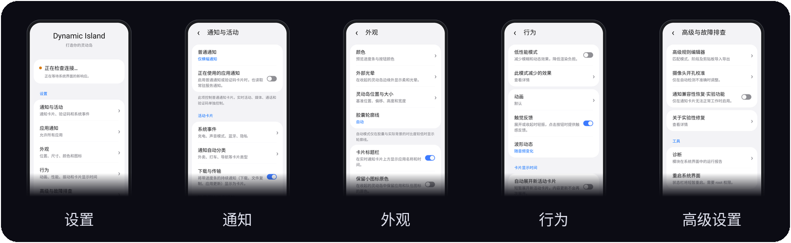

<p align="center">
  
</p>

<h3 align="center">让状态栏动起来!</h3>

<p align="center">
  <b>适用于三星 One UI 的 Dynamic Island。</b><br>
  摄像头孔周围的药丸条,可展开为通话、音乐、导航、计时器和通知的实时卡片。
</p>

<p align="center">
  <a href="https://github.com/sampple-korea/dynamicisland/releases/latest"></a>
  
  
  <a href="LICENSE"></a>
</p>

<p align="center">
  <a href="https://github.com/sampple-korea/dynamicisland/releases/latest"></a>
  <a href="https://apps.obtainium.imranr.dev/redirect?r=obtainium://add/https://github.com/sampple-korea/dynamicisland"></a>
</p>

<p align="center">
  <a href="README.md">English</a> · <a href="README.ko.md">한국어</a> · <a href="README.ja.md">日本語</a> · <b>中文</b> · <a href="README.ru.md">Русский</a> · <a href="README.tr.md">Türkçe</a> · <a href="#功能">功能</a> · <a href="#安装">安装</a>
</p>

### 胶囊显示的一切,都变成卡片

药丸条位于原来 Now Bar 胶囊的位置,并展开为卡片。

<p align="center">
  
</p>

Dynamic Island 把状态栏中三星的 Now Bar 胶囊替换为可以长成卡片的药丸条。One UI 放在胶囊里的所有内容(通话、计时器、录屏、投屏、导航、音乐播放器)都会变成卡片,普通通知也一样:消息、验证码、下载,以及应用只以文字形式写出的外卖、打车和路线更新。它是运行在 System UI 内部的 LSPosed 模块,带有 One UI 风格的设置应用和规则管理器。

## 截图

<p align="center">
  
</p>

<p align="center">
  
</p>

这些图片由应用自己的绘制代码在测试环境的模拟手机上绘制(见 `scripts/readme_images.py`);它们不是真机照片,应用图标也只是简单图形。

## 0.1.13更新

本稳定版汇总0.1.13开发版的改动：随音乐变化的共享辉光、整理后的设置、可选充电和耳机卡片，以及录屏计时、系统字体和长按实时通知崩溃修复。新增圆形电量表并改进收起时的信息布局，卡片默认圆角为28dp，可选调整范围为0–48dp。三星录音机的实验性波形默认关闭，可在“高级设置与故障排除”中按设备兼容情况开启。

[发布说明](docs/release-notes/0.1.13.md) · [当前卡片的36种示例](docs/cards-overview-0.1.13.png)（示例数据，包含可选功能）。

## 功能

- **实时通知变成卡片:** System UI 中的每个进行中的活动都有紧凑的药丸条和展开的卡片:标题栏、计时器、描述、普通/分段/不确定进度条、图标或文字按钮、自定义小标签视图、工作资料徽章。包括通话、投屏、录屏、计时器和音乐播放器(进度条、随封面着色的光晕、波形、输出路由)。
- **普通通知变成卡片:**
  - 消息和横幅以岛卡片的形式打开,取代系统的悬浮横幅(通话和闹钟仍使用系统横幅)。
  - 验证码会得到带“复制”按钮的卡片(可选自动复制,并标记为敏感内容)。
  - 下载、复制和更新会变成进度卡片,包括只用文字写出的进度(“73%”、“12 MB / 40 MB”)。显示卡片时,可以隐藏通知栏中的原始通知行。
  - 语音聊天和 VoIP 通话会得到带通话时长和结束按钮的通话卡片。
- **以数据形式存在的规则:** 外卖、取餐、包裹、打车、路线、可穿戴设备和电池的卡片,来自 LiveBridge 词典格式的规则文件。模块自带一份由一年半真实通知整理成的韩语规则文件和一份英语规则文件;不会下载任何东西,模块也没有网络权限。你可以从剪贴板添加自己的规则。
- **系统事件:** 充电、低电量、声音模式、带电量的蓝牙音频、相机/麦克风/位置信息使用中,以及快捷设置反馈(勿扰、飞行模式、省电、手电筒、热点、自动旋转)。
- **应用控制:** 为普通通知功能设置应用黑名单或白名单。实时通知、媒体、通话和系统事件从不被过滤。
- **动效:** 基于弹簧的动画,带挤压和拉伸,药丸条与卡片之间有液态桥,卡片从药丸条中长出来。
- **One UI 风格设置应用:** 带子页面的分组卡片中心,支持英语、韩语、日语、简体中文、俄语和土耳其语。
- **六种语言本地化：** 设置、灵动岛自身文案和阶段名称共用以英语为源的 Android 字符串。其他应用的通知原文保持不变，内置内容识别仍使用韩语和英语规则。无需修改 Java 即可添加语言，详见[翻译指南](docs/TRANSLATING.md)。
- **安全性:** 当 System UI 反复崩溃时,崩溃保护会关闭模块;各组 Hook 相互隔离;诊断页面显示模块在 System UI 内做了什么。

## 功能详解

### 岛本身

- **药丸条与卡片。** 一个紧凑的黑色药丸条环绕摄像头孔并从中长出。点按即可打开卡片;每张卡片显示应用、正在发生的事和相应按钮。多件事同时发生时按重要程度叠放(依次为通话、悬浮卡片、导航、录制、计时器、事件、实时通知、任务、音乐、充电)。
- **手势。** 按住并点按药丸条即可展开;左右滑动可在各项之间切换;把某项滑走,它会收进一个小气泡(点按气泡可取回);可拖动已打开的卡片(它们像橡皮筋一样跟随手指;横向拖动会移动一张卡片);点按卡片会打开其应用,可按它的按钮,也可拖动音乐卡片的进度条;向下拖动药丸条可拉下通知栏(拖动会被回放到 System UI)。
- **会自己收起。** 展开的岛在你设定的时间后关闭,暂停的播放器也会在你设定的时间后退场。
- **不挡路。** 在锁屏、息屏显示、全屏应用以及横屏手机上会隐藏(平板保持显示)。解锁后会稍等片刻再出现。你正在使用的应用的内容会先压住,离开该应用后再飞入。 开启 **行为 → 竖屏全屏时仍然显示**（默认关闭）后，可在相机等隐藏状态栏的竖屏应用中继续显示正在进行的活动。锁屏、息屏显示或没有活动内容时仍会隐藏。
- **干净地接管。** 三星自己的进行中活动胶囊、它的动画,以及药丸条下方的状态栏图标和时钟,会被淡出或保持隐藏,岛把同样的信息放在一处。同一通知的重复项(例如 LiveBridge 应用的副本)不会显示两次。
- **浑然一体的外观。** 卡片后面是磨砂玻璃(三星的模糊效果),颜色取自应用图标或专辑封面,白色字形头像会换成深色圆盘上的应用图标以保持可读,还有工作资料徽章、系统字体,以及打开、关闭和按下按钮时的触感反馈(可关闭)。
- **动效。** 每个动作都是有各自手感的弹簧:药丸条落下并弹一下,尺寸变化时挤压和拉伸,倒入卡片再鼓回来,卡片被拉回上方离开。药丸条与卡片之间的液态桥像沙漏一样变细、断开,再轻轻晃着弹回,相遇时又融为一体。按下按钮只会让那张卡片出现按压效果。

### 实时通知(三星进行中活动)

- One UI 在 Now Bar 胶囊中显示的所有内容都会变成卡片:带时间的应用标题栏、标题、第二行和图标、描述、计时器(正计时或倒计时,位于主要或次要位置)、普通、分段(带标记图标)和不确定的进度条、每个动作可设颜色的圆形图标按钮或文字按钮、应用自定义的小标签视图,以及工作资料徽章。
- **Android 16 ProgressStyle:** 彩色分段(已用和剩余)、里程碑点和追踪图标。
- **通话:** 来自系统通话胶囊的来电者、通话时长、静音/扬声器/挂断按钮。
- **计时器和秒表**(数字滚动,秒表精确到百分之一秒)、**录屏**、**投屏**、**导航**。
- **音乐播放器:** 进度条、播放/暂停/上一首/下一首,保持长宽比的专辑封面,随封面着色并跟随卡片形状的光晕,由真实音频输出驱动的波形(也可以选择柔和的动画),以及声音去向的标签(带电量的蓝牙设备、有线耳机、投屏目标)。

### 普通通知变成卡片

- **消息和横幅** 以岛卡片(发送者、消息、应用图标或头像、通知自带的按钮、点按打开)的形式打开,取代悬浮横幅。通话、闹钟和全屏通知仍使用系统横幅。通知本身留在通知栏里,铃声照常。
- **验证码:** 含验证码的文字会打开一张带验证码和“复制”按钮的卡片,还可以选择立即复制(标记为敏感,剪贴板预览会隐藏)。检测会给触发词及其与验证码的距离打分,并排除电话号码、价格、订单号和广告;同一个验证码到达两次(重新发布或被另一个应用镜像)时只显示一张卡片。
- **下载、文件复制、上传和应用更新:** 带有通知进度条和按钮的进度卡片,没有接入 One UI 实时通知的应用也适用。只用文字写出的进度(“正在下载 73 %”、“12.4 MB / 40 MB”)同样能识别。显示卡片时,可以隐藏通知栏中的原始通知行。
- **语音聊天和 VoIP 通话**(KakaoTalk 语音通话、Discord 语音等)会得到带通话时长和结束按钮的通话卡片。
- 哪些应用会变成卡片,可以用黑名单或白名单限制。

### 由规则生成的卡片

- 一条 **规则** 把通知变成分阶段的卡片:例如 *已下单、制作中、配送中、即将到达、已送达*。模块自带一份由一年半真实通知整理成的韩语规则文件:
  - **外卖和取餐:** Coupang Eats、Baemin、Yogiyo、Pass order、Starbucks、Subway、Lotteria、McDonald's。
  - **包裹:** Smart Parcel(CJ 等)、Coupang、Kream、AliExpress、Kurly、Gmarket、11st 以及各快递公司自己的应用。
  - **导航:** Naver Map、T map、Kakao Map、Kimgisa 和 Google Maps(步行、骑行、下车、到达,药丸条上显示距离)。
  - **打车:** Kakao T、T map 打车、Uber、Onda(呼叫中、已接单、临近、乘车中、已到达)。
  - **可穿戴设备和耳机:** Galaxy Ring、Watch 和 Buds 的连接与断开(重复的会被冷却时间压住)、充满电以及低电量百分比。
  - **设备连接:** 刚连接上的蓝牙或配件设备的名称。
  - 一份不会生成卡片的邮件、聊天、社交和新闻应用清单。
- **英语规则** 是根据英语应用措辞通知的方式为本项目编写的;没有复制任何 LiveBridge 文件。覆盖范围:
  - **外卖配送:** DoorDash、Uber Eats、Grubhub、Postmates、Instacart、Domino's、Pizza Hut、Starbucks、Chipotle、Deliveroo、Just Eat、Wolt、Glovo 等(已下单、准备中、配送中、即将到达、已送达)。
  - **包裹:** Amazon、UPS、FedEx、USPS、DHL、Royal Mail、Shop、Evri、Canada Post、Australia Post 等(已创建面单、运输中、到达本地网点、派送中、已送达)。
  - **网约车:** Uber、Lyft、Bolt、Grab、Ola、DiDi、FREE NOW、Cabify、inDrive(寻找司机、已分配司机、在路上、已到达、行程结束)。
  - **导航:** Google Maps、Waze、Citymapper、HERE、TomTom、MapQuest 等(带英里、英尺或公里距离的转弯、下车、到达)。
  - **配件:** Pixel Buds、Fitbit、Garmin、Galaxy Wearable 等配件应用的连接、断开、充满电和低电量百分比。
  - 聊天、邮件、社交、视频和新闻应用不在其中。阶段名称跟随手机语言:英语手机显示英语,韩语手机显示韩语。
- 已完成流程的卡片会在几分钟后消失,其他的在数小时后消失;全天反复出现的事件每个冷却期只显示一次;信号可以带一个百分比,它会成为卡片的进度。
- 规则文件使用 LiveBridge 词典的格式。可能让手机卡死的模式(失控的正则表达式)在读取文件时会被拒绝,过长的文字在匹配前会被截断。

### 规则管理器

- **每条规则都有开关**,有显示其阶段、应用和模式的列表,以及每条规则的详情页。
- **在不改动模块规则的前提下添加:** 给某个阶段命名、为它添加模式、增加阶段(最多九个)、添加应用(从已安装的应用中选)或排除的措辞;一键撤销对某条规则的所有更改。
- **新建规则:** 为某个应用或你自己的措辞创建规则。
- **试一试通知:** 输入应用和文字,立刻看到触发了哪条规则、在哪个阶段、是否会被当作验证码读取,以及它带有什么进度。
- 通过剪贴板以 JSON **导入/导出** 你的规则;也可以全部重置。

### 系统事件

- **充电**(快充或无线,带实时百分比)、**低电量**、**声音模式**(静音、振动、响铃)、**蓝牙音频** 连接(带电量)。
- **可选设备卡片：** 在 **通知 → 系统事件** 中可启用充电详情、充电统计以及有线/USB耳机提醒，默认均关闭。充电卡片保留事件优先级，显示时替代短暂的充电弹窗。统计需启用充电卡片；关闭各选项会停止相应采集。功率为电池侧估算值，按屏幕状态划分的电量变化根据实际观测区间估算。**高级设置 → 摄像头校准** 可设置0–16dp额外文字间距，0保留原有间距。
- **三星电池充电特效：** **通知 → 系统事件 → 显示三星电池充电特效**默认关闭。隐藏状态栏电池展开及流动色彩的充电特效，保留普通电池图标、电量、充电标记、提示音和灵动岛提醒。根据实际存在的接口处理已检查的One UI 9 Compose路径及BatteryEvent调度路径，不支持的版本保持原有行为。
- **相机、麦克风和位置信息使用中:** 显示哪个应用在使用哪个传感器;点按会打开该应用的权限页面。(位置信息默认关闭,因为导航和天气应用会全天使用它。)
- **快捷设置反馈:** 勿扰、飞行模式、省电、热点和自动旋转的开启与关闭。
- **手电筒亮度:** 手电筒亮着时,点按岛会打开一张带有 iOS 风格大滑块的卡片,用于调节亮度级别(Galaxy 手机为 5 级,从相机读取)和关闭按钮。对于手电筒只有一个亮度级别的手机,卡片没有滑块,只有状态和关闭按钮(关闭 *手电筒卡片* 开关则改用普通的“手电筒已开启”弹窗)。
- 每一组都可以单独关闭。

### 设置应用

- **外部光晕（默认开启，仅音乐会话）：** 即使音乐胶囊隐藏，所有紧凑胶囊也共享音乐会话的配色和声音反应。专辑联动使用与波形相同的颜色；暂停时变淡，会话结束后保持最后的配色，在1.2秒内平滑淡出。可选仅音乐或所有活动，预览调整亮度（默认45%）及动态强度（0–100%，默认50%）。保留主题色及独立预设、HSV、HEX配色；低性能模式下关闭。
- **低性能模式（默认关闭）：** 内容模糊改为交叉淡化，背景模糊改为不透明黑色卡片。专辑色调、封面、波形及图标静态显示，并停止音频分析；实际电池状态继续更新。持续动态最高 30fps，触摸反馈与展开/收起最高 60fps。保留单项设置，关闭模式后恢复应用；通知、通话、计时器和音乐控制继续工作。
- 六个分组：**通知与活动**、**应用通知**、**外观**、**行为**、**高级与故障排查**、**应用信息**。支持英语、韩语、日语、简体中文、俄语和土耳其语，以及浅色和深色主题。大多数设置在几秒内生效，无需重启系统界面。
- **位置与尺寸：** 实际状态栏实时预览，自动或自定义宽度，滑块、数字输入及逐步微调。位置、尺寸和相机校准分别重置。摄像头开孔校准位于高级设置。
- **通知与应用：** 普通通知可关闭、仅横幅或包含静默通知。常驻服务通知默认不包含。应用过滤仅影响普通通知卡片；支持按名称或包名搜索、仅显示已选应用，以及保存和取消。
- **外观与行为：** 默认或自定义强调色，可取消的 HSV/HEX 编辑器；事件图标默认大号，可选小号；充电电池图标默认隐藏。动画预览使用实际渲染器，选择后立即保存。波形可随音频变化或播放演示动画。
- **时间与修复：** 活动自动展开默认关闭。启用后的显示时间（默认 4 秒）、手动展开卡片自动收起（6 秒）和暂停音乐保留（60 秒）分别设置。实验性通知修复用于兼容性问题，默认关闭。
- **语言与状态：** 在应用信息中更改设置应用语言，卡片跟随设备语言。连接检查需要系统界面的新响应，不会将旧诊断报告当作当前连接。返回时恢复滚动位置。

### 可靠性

- Hook 按 **相互隔离的分组** 安装:无法挂到你的 System UI 版本上的那一组不会拖垮其他组。每个 Hook 主体和每个数据源都被隔离起来,所以失败只会变成一行日志,而不是 System UI 崩溃。
- **崩溃保护** 会在 System UI 反复崩溃或启动不稳定后关闭模块,在系统更新后或十二小时后忘记这个判定,并保留最近一次崩溃的原因。
- **诊断页面** 显示 System UI 版本、启动阶段、未能挂接的 Hook、最近的错误和上一次崩溃,可直接复制到 issue 中。
- 如果 System UI 一直没有报告它的状态栏,岛会在十五秒后自己创建窗口。
- 应用 **没有网络权限**,没有任何数据离开手机。

## 系统要求

- 运行 One UI 7 / 8 / 9(Android 15 / 16 / 17)并使用原厂 System UI 的三星设备。One UI 8 和 9 已在真机上使用过;One UI 7 的支持是新增的,只对照了一个 System UI 版本,没有在真机上确认(见 [docs/COMPATIBILITY.md](docs/COMPATIBILITY.md))。
- LSPosed(模块最低 SDK 为 35)。
- 只有可选的 **重启 System UI** 按钮需要 root。

## 安装

1. 从项目的 **Releases** 安装已签名的 Dynamic Island APK。如果没有,请从源码构建(见下)。
2. 在 LSPosed 中启用 **Dynamic Island**,并把作用域设为 **System UI**(`com.android.systemui`)。
3. 重启 System UI(应用中的 **重启 System UI** 按钮,或重启手机)。
4. 从启动器打开 Dynamic Island。更改在几秒内生效,无需重启。

## 设置

| 页面 | 内容 |
|---|---|
| 通知与活动 | 普通通知模式、系统事件、自动分类、下载、通话及验证码 |
| 应用通知 | 除所选外全部允许或仅允许所选；可搜索列表；仅影响普通通知卡片 |
| 外观 | 强调色、位置与尺寸、卡片标题、图标尺寸、充电图标及通知面板音乐 |
| 行为 | 默认或经典动画、振动、音频或演示波形、独立卡片显示时间 |
| 高级与故障排查 | 规则模式与阶段、剪贴板导入导出、相机校准、实验性修复、诊断、重启系统界面 |
| 应用信息 | 设置应用语言、版本、作者和致谢 |

## 无法使用时

重启 System UI 后,在应用中打开 **高级与故障排查 → 诊断**。它会列出 System UI 版本、启动阶段、未能挂接的 Hook、错误和上一次崩溃。用 **复制报告**,并连同 issue 一起发送。

## 从源码构建

需要 JDK 17+ 和 Android SDK(compile SDK 36)。

```bash
./gradlew assembleRelease     # 未签名的 APK 位于 app/build/outputs/apk/release
KEYSTORE_PASSWORD=... scripts/sign.sh   # 构建、对齐并签名 -> release/DynamicIsland-<version>.apk
./gradlew testReleaseUnitTest # 单元测试和无头渲染测试
./gradlew testReleaseUnitTest -Prender # 可选：生成供人工检查的PNG
```

`scripts/sign.sh` 从 `KEYSTORE_PASSWORD` 读取密钥库密码,首次运行时会在 `release-keys/` 中创建自签名密钥(已被 git 忽略)。请妥善保管:更新必须用同一把密钥签名。源码结构、Hook 说明、规则格式和测试设置见 [`docs/DEVELOPMENT.md`](docs/DEVELOPMENT.md)。

## 发布

本 README 描述当前源码；等待发布的变更可能尚未包含在最新稳定版 APK 中。

已签名的 APK 发布在 [Releases](../../releases) 页面;构建是自动化的(见 [`docs/DEVELOPMENT.md`](docs/DEVELOPMENT.md))。每个版本都用同一把密钥签名,因此新版本可以作为更新直接安装在旧版本之上。

## 隐私

模块运行在 System UI 内部,读取 System UI 已经持有的通知。它没有网络权限,也不会向任何地方发送任何东西。设置和诊断报告都留在设备上;报告中不含通知文字。

可选的并发麦克风波形通过短时内存缓冲区计算音量。默认关闭，不保存或传输音频。

## 免责声明

Dynamic Island 是独立的非官方项目,与三星无关,也未获三星认可。它会 Hook System UI 的私有类,这些类可能随任何更新而改变;它已在运行 One UI 8 和 9 的真机上使用过,而 One UI 7 和 Nothing OS 尚未在真机上确认(见 [docs/COMPATIBILITY.md](docs/COMPATIBILITY.md))。使用风险自负。

## 许可证

[MIT](LICENSE) © 2026 sampple-korea。

## 作者 [sampple-korea](https://github.com/sampple-korea)

## 致谢

- [LiveBridge](https://github.com/appsfolder/livebridge) — 本项目读取的规则文件格式(未包含任何 LiveBridge 文件)
- [Xposed API](https://api.xposed.info/)(Apache-2.0,`app/libs/xposed-api-82.jar`)和 [LSPosed](https://github.com/LSPosed/LSPosed)
* @cryyear 的 DynamicIsland — 本项目最初由修改该模块的 APK 开始，后来使用自己的代码库和架构重新实现。目前独立开发和维护。
- Telegram 用户 [@UnkilBonki](https://t.me/UnkilBonki) — 错误修复、测试和帮助。
